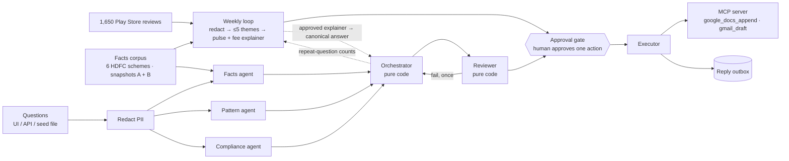
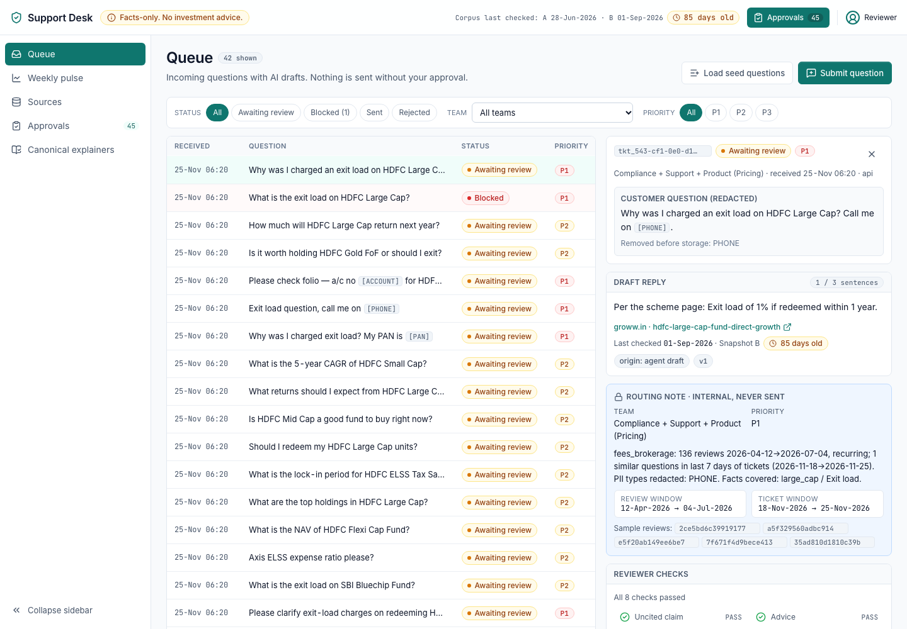
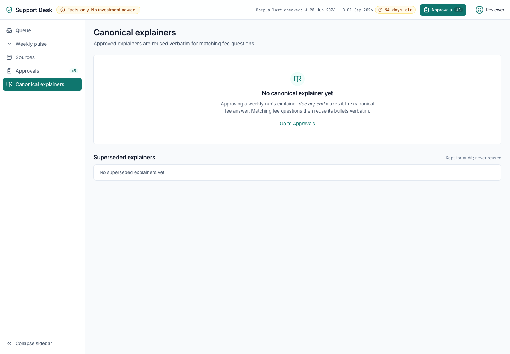
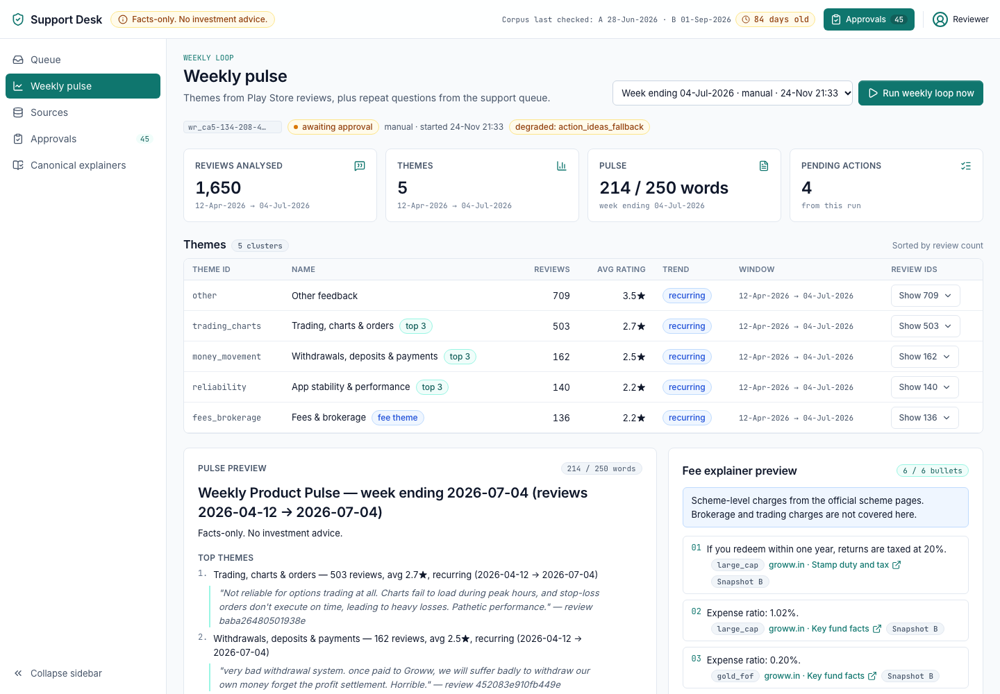
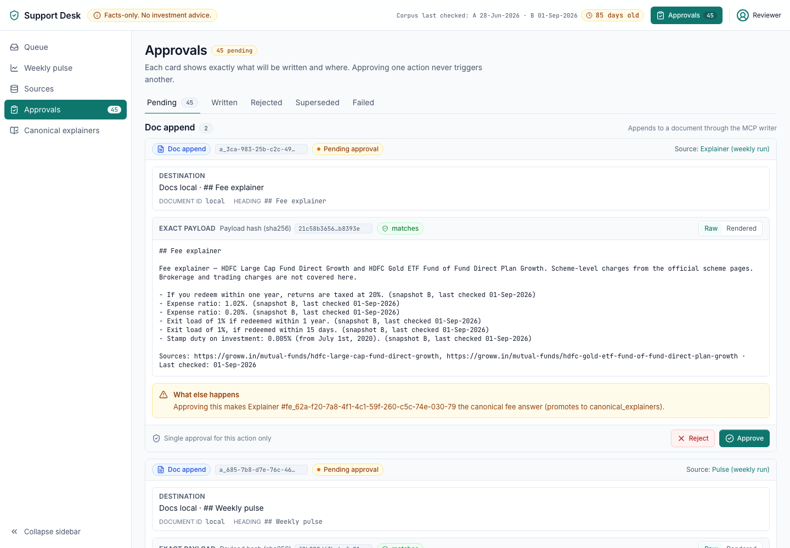

# The Support Desk

> **Facts-only. No investment advice.**

A support and product loop for Groww's six HDFC Mutual Fund schemes, the same product and corpus as Milestone 1.

- **Weekly loop.** Turns 1,650 Play Store reviews into at most five themes, a pulse of 250 words or fewer, and a fee explainer.
- **Response loop.** Three agents run in parallel (Facts, Pattern, Compliance). Code then writes a cited reply draft, and a reviewer checks it.
- **Approval gate.** A person approves every Google Doc append, Gmail draft and customer reply before it happens. Nothing is sent automatically.

| | |
| --- | --- |
| **Hosted app** | _Pending: the Render service hasn't been created yet ([docs/deploy.md](docs/deploy.md), plan P11.3)._ |
| **Design** | [docs/architecture.md](docs/architecture.md) · brief: [docs/problemStatement.md](docs/problemStatement.md) · plan: [docs/implementation-plan.md](docs/implementation-plan.md) · evals: [docs/eval.md](docs/eval.md) |
| **Sample outputs** | [samples/](samples/): reviews CSV, five questions with drafts, the appended doc entry and the email draft |
| **Eval results** | [evals/results/latest.md](evals/results/latest.md) |

---

## Contents

1. [Architecture](#1-architecture)
2. [Setup](#2-setup)
3. [Sources](#3-sources)
4. [Where the approval gate sits](#4-where-the-approval-gate-sits)
5. [How the two loops connect](#5-how-the-two-loops-connect)
6. [The fee issue in the reviews](#6-the-fee-issue-in-the-reviews)
7. [Running the evals](#7-running-the-evals)
8. [Sample artifacts](#8-sample-artifacts)
9. [Known limits](#9-known-limits)
10. [Repository layout](#10-repository-layout)

---

## 1. Architecture

One process serves everything:

- **FastAPI** for the HTTP API and the built React UI
- **APScheduler** for the weekly cron
- **LangGraph** for the response loop
- **The Milestone 3 TypeScript MCP server**, spawned over stdio, for `google_docs_append` and `gmail_draft`

State is kept in SQLite.



**Rules the code enforces** (architecture §1.3, §6):

- **Redact first.** `pii.redact()` runs before any text is stored, logged or sent to a model. A storage guard raises `PIILeakError` if a raw PAN, Aadhaar number, phone number, email, OTP or account number reaches a repository write.
- **Models pick, code writes.** Each agent makes one model call, and that call returns an id from a closed list: a `(scheme, section)` pair, a theme id, or a compliance flag. Every reply sentence is either verbatim corpus text or a fixed template. The reviewer checks that by substring match; it doesn't use a model.
- **Caps by construction.** These are enforced by the writers and re-checked by validators:
  - at most 5 themes
  - a pulse of 250 words or fewer
  - an explainer of 6 bullets or fewer, with 2 links and a last-checked date
  - a reply of 3 sentences or fewer
  - 1 rework round
  - 5 refinements
- **Model failure is safe.** If the model errors, times out or goes over the rate budget, that agent falls back to the code rules. Every ticket still gets a draft or a "not covered" reply. The regex compliance detectors are ORed with the model's flag, so a model miss can't let advice through.

The UI has five views: Queue, Weekly pulse, Sources, Approvals and Canonical explainers. Every view shows the disclaimer banner. The UI is rebuilt from the Stitch design ([docs/design/stitch/](docs/design/stitch/)).

| Queue (ticket with PII redacted, routing note, reviewer checks) | Canonical explainers (active explainer and reuse log) |
| --- | --- |
|  |  |
| **Weekly pulse** | **Approvals** |
|  |  |

More screenshots are in [ui/tests/__screenshots__/](ui/tests/__screenshots__/): a blocked ticket, Sources, and the snapshot drift tab. To refresh them, run `cd ui && SCREENSHOTS=1 npx playwright test -g screenshots`.

---

## 2. Setup

### Local

Needs Python 3.11+ with [uv](https://docs.astral.sh/uv/), and Node 22+.

```bash
cp .env.example .env          # optional: GROQ_API_KEY, ADMIN_TOKEN
make install                  # uv sync + MCP server build + UI deps
make ui                       # build the UI into ui/dist (served by FastAPI at /)
make dev                      # http://127.0.0.1:8000
```

On first boot with an empty database, the app does three things:

1. runs the weekly loop once
2. loads [data/seed_questions.json](data/seed_questions.json) through the normal ingress path
3. sets `"seeded": true` on `/api/health`

Without `GROQ_API_KEY`, the agents use the rules-only backend (`LLM_PROVIDER=cues_only`). It is deterministic and needs no network, but its picks are less accurate.

Other commands:

| Command | What it does |
| --- | --- |
| `make test` | `pytest` (unit, integration and PII sweep) |
| `make lint` | `ruff`, plus `mypy --strict` on `app/guardrails` and `app/gate` |
| `make ui-test` / `make ui-e2e` | UI lint, types and unit tests / Playwright + axe against a throwaway API |
| `make evals` | The three eval suites on the rules backend (§7) |
| `python -m app.weekly.pipeline` | One weekly run from the command line |
| `python -m app.response.cli ask "…"` | One question through the response loop from the command line |

### Docker

```bash
make docker                                   # multi-stage: node:22 builds UI + MCP, python:3.11-slim runs
ADMIN_TOKEN=change-me make docker-run         # :8000, state in the named volume support-desk-state
ADMIN_TOKEN=change-me make smoke              # health, seeding, UI, weekly run, ticket, approval
```

### Hosting

The Render blueprint is [render.yaml](render.yaml). The steps, the secrets and the free-tier trade-offs are in [docs/deploy.md](docs/deploy.md).

The in-app scheduler runs the weekly loop every **Monday 09:00 IST** (`WEEKLY_CRON`). Free hosts can sleep through that time, so [.github/workflows/weekly.yml](.github/workflows/weekly.yml) sends the same trigger from GitHub Actions as a backup. It sends `trigger=cron`, so a run on unchanged input is a no-op and the two triggers can't double-run.

---

## 3. Sources

Every factual sentence in a reply or in the fee explainer is copied verbatim from one of these **official public scheme pages**. Each claim carries its own snapshot's "last checked" date.

| Scheme id | Scheme | Source page | Snapshots |
| --- | --- | --- | --- |
| `large_cap` | HDFC Large Cap Fund | https://groww.in/mutual-funds/hdfc-large-cap-fund-direct-growth | A, B |
| `mid_cap` | HDFC Mid Cap Fund | https://groww.in/mutual-funds/hdfc-mid-cap-fund-direct-growth | A, B |
| `small_cap` | HDFC Small Cap Fund | https://groww.in/mutual-funds/hdfc-small-cap-fund-direct-growth | A, B |
| `gold_fof` | HDFC Gold ETF Fund of Fund | https://groww.in/mutual-funds/hdfc-gold-etf-fund-of-fund-direct-plan-growth | A, B |
| `silver_fof` | HDFC Silver ETF FoF | https://groww.in/mutual-funds/hdfc-silver-etf-fof-direct-growth | A |
| `elss_tax_saver` | HDFC ELSS Tax Saver Fund | https://groww.in/mutual-funds/hdfc-elss-tax-saver-fund-direct-plan-growth | B |

| Snapshot | Files | Last checked | NAV date | Shape |
| --- | --- | --- | --- | --- |
| **A** | `data/parsed/*.json` | **28-Jun-2026** | 25-Jun-2026 | 7 sections per scheme |
| **B** | `data/processed/hdfc_*.json` (raw HTML kept in `data/raw/`) | **01-Sep-2026** | 31-Aug-2026 | 4 sections per scheme (Gold FoF: 3), normalized onto the same 7 |

How the two snapshots are combined:

- When both snapshots have a section, **the newer one wins** (B over A). A claim never mixes snapshots.
- The Sources view shows both versions side by side, plus a drift report. For example, the large-cap expense ratio moved from 1.04% to 1.02%.
- Snapshot B has some scraper artifacts: an AMC-wide AUM, a template launch date, a star rating and a malformed `data_points` field. These are quarantined and never quoted (architecture §5.1).

**Investor-education links** are used in refusals:

- AMFI: https://www.amfiindia.com/investor-corner
- SEBI: https://investor.sebi.gov.in/

Replies may only link to `groww.in`, `hdfcfund.com`, `amfiindia.com` and `sebi.gov.in`. The reviewer rejects any other URL.

**Reviews** come from [data/normalized_reviews.json](data/normalized_reviews.json): 1,650 Google Play reviews from 2026-04-12 to 2026-07-04. The Milestone 2 baseline themes in [data/analyzed_themes.json](data/analyzed_themes.json) are the taxonomy seed and the regression baseline.

---

## 4. Where the approval gate sits

The gate sits between **every producer** and **every side effect** (architecture §10).

- **Producers:** the weekly loop, the response loop, and human edits.
- **Side effects:** a Google Doc append, a Gmail draft, and a reply written to the outbox.

Producers can only *propose* a `ProposedAction`. The action's exact payload is frozen with a SHA-256 hash when it's proposed. Only [app/gate/executor.py](app/gate/executor.py) performs side effects, and only from `POST /api/actions/{id}/approve` for that one id. A CI grep check fails the build if any other module calls MCP or writes to the outbox.

| Action | Proposed by | On approval |
| --- | --- | --- |
| `doc_append` | Weekly loop (pulse, fee explainer) | MCP `google_docs_append`. For the explainer, it also promotes the explainer to canonical. |
| `email_draft` | Weekly loop (pulse, fee explainer) | MCP `gmail_draft`. This creates a **draft** only. The MCP server has no send tool, and a test asserts that. |
| `reply_send` | Response loop, only for a draft the reviewer passed | Inserts the reply into `outbox_replies` |

Guarantees:

- **What you see is what's written.** The approval screen renders the stored payload, and the executor re-checks its hash before executing.
- **One approval, one effect.** There's no batch approve.
- **Exactly once.** A compare-and-set on the status, plus an idempotency key that the MCP server de-duplicates on.
- **Last-mile PII scan.** A hit fails the action with `PII_BLOCK`.
- **Audit row.** Every transition is recorded.
- **Blocked drafts can't be approved.** When the reviewer blocks a draft, there's no Send button at all. A person can edit, refine or reject it.

`MCP_BACKEND=local` (the default, and what the hosted demo uses) writes to `samples/`-style Markdown files instead of Google. `MCP_BACKEND=google` uses Milestone 3's OAuth flow.

---

## 5. How the two loops connect

**Repeat questions → weekly pulse** (architecture §9.1):

- Every ticket gets a fingerprint: a simhash of the redacted question plus the agents' picks.
- When one fingerprint appears **5 or more times in the last 7 days of tickets**, the next pulse lists it under *Repeat questions from support*, with its count and window.
- These clusters also raise ticket priority and feed the orchestrator's **disagreement** note. That note fires when Facts has a clean answer but Pattern sees a rising or repeated issue: the draft is still provided, and the ticket is escalated instead of closed.

In the sample run, six exit-load rephrasings show up as one cluster:

```text
## Repeat questions from support (tickets, 2026-11-18 → 2026-11-25)
- "Why was I charged an exit load on HDFC Large Cap Fund?" — 6× (2026-11-18 → 2026-11-25) [possible duplicate burst]
```

**Approved fee explainer → canonical answer** (architecture §9.2):

1. A person approves the fee explainer's `doc_append`. This promotes the explainer to the canonical fee answer.
2. Its coverage is expanded to scheme families whose corpus text is identical: the equity family (Large/Mid/Small Cap) and the FoF family (Gold/Silver). The expansion is checked by comparing the text, never assumed.
3. A later fee question about a covered `(scheme, section)` reuses the explainer's bullet verbatim. This is decision-table row 3, with `origin=canonical`.
4. The reuse is logged in the Canonical explainers view.

In the sample run, a Mid Cap exit-load question reused the Large Cap bullet through the equity family ([question 5](samples/five_questions_with_drafts.md#5-canonical-reuse-after-the-fee-explainer-was-approved)).

The two loops use **two clocks**:

- Review trends describe the data window, which ends 2026-07-04.
- Repeat questions describe the last 7 days of tickets.

The pulse labels both windows separately.

---

## 6. The fee issue in the reviews

The weekly loop's fee theme is **`fees_brokerage`**:

- **136 reviews**, from 2026-04-12 to 2026-07-04
- average rating 2.2★
- trend: recurring

These reviews are about **brokerage and hidden charges**. Counting whole words in the review text: "charges" appears in 71 reviews, "brokerage" in 60 and "hidden" in 14. **None of them mention exit load.**

**Exit-load confusion comes from the support side.** It shows up as the repeat-question cluster in tickets, which the pulse reports under *Repeat questions from support*.

Neither source is answered beyond what the corpus holds:

- The **fee explainer** covers the scheme-level charges the corpus does hold: exit load, expense ratio, stamp duty and tax, for `large_cap` and `gold_fof` (config `EXPLAINER_SCHEMES`).
- **Brokerage and trading-charge questions** aren't in any scheme page. They're routed to *Support + Product (Pricing)* as "not covered" rather than answered (architecture §7.5, edge case G4).

---

## 7. Running the evals

The three suites from brief §8 run against the **assembled app over HTTP**. Each run gets a fresh temp database, `APP_ENV=test` and the local MCP backend. The full spec is [docs/eval.md](docs/eval.md).

| Suite | What it checks |
| --- | --- |
| 1. Feasibility (FEAS-01…13) | Every ticket gets a draft or "not covered"; 3 structured agent outputs; ≤5 themes with ids and window; caps; unattended weekly run; baseline regression |
| 2. Correctness of edits (EDIT-01…18) | Snapshot → one operation (approve, edit, reject, refine, re-run) → snapshot → exact expected diff |
| 3. Grounding and compliance (GC-01…13) | See below |
| 4. Agent quality (AQ-01…06) | Pick accuracy, compliance recall, false refusals, fingerprint quality and latency. Informational only, not gating. |

What Suite 3 checks:

- 15 sampled claims traced to corpus text, plus every claim in the pool
- out-of-scope questions
- snapshot resolution
- advice and return requests in early, mid and late waves, in **both** loops
- PII in tickets and in reviews
- a final literal-value sweep of the DB, logs, checkpoints, `samples/` and MCP outputs
- reviewer rejections

```bash
make evals                                            # rules backend, deterministic, as in CI
uv run python -m evals.run_all --suite grounding      # one suite
uv run python -m evals.run_all --case GC-05           # one case and its prerequisites
uv run python -m evals.run_all --backend groq --seed 42   # graded run (needs GROQ_API_KEY; see below)
```

Each run writes `evals/results/{timestamp}.json` and [evals/results/latest.md](evals/results/latest.md).

**Latest results** (rules backend, seed 42):

| Suite | Result |
| --- | --- |
| Feasibility | 12/13 (FEAS-03, the model ERROR rate, only runs in graded mode) |
| Edits | 18/18 exact diffs |
| Grounding & compliance | 13/13, with 15/15 sampled claims traced and **0 PII hits** across 6 locations |

The informational AQ-02 (Pattern pick accuracy 0.75 against a 0.80 target) is the rules backend's known weak spot.

**About the graded run.** A full graded run is about 600 model calls and roughly 280K tokens. That's more than one day of Groq's free tier (200K tokens/day, and the client paces to 80% of it). Run it on a paid key, or run one suite per day with `--suite`. Splitting costs more in total: each `--suite` run starts a fresh app and repeats the ~93-ticket setup, so each one is roughly 130–170K tokens. In graded mode the harness sets `LLM_MAX_WAIT_S=150`, so calls wait for per-minute capacity instead of falling back to the rules, which would count against FEAS-03.

---

## 8. Sample artifacts

The script [scripts/build_samples.py](scripts/build_samples.py) produces everything in [samples/](samples/). Nothing in that folder is written by hand. The script starts the real app on a throwaway database, runs the weekly loop, submits the questions, and approves real actions through the gate. The local MCP backend writes the doc entry and the email draft.

```bash
uv run python scripts/build_samples.py --backend groq   # live agent picks (~16 Groq calls)
uv run python scripts/build_samples.py                  # rules only, no network
```

[tests/test_samples.py](tests/test_samples.py) checks that the committed samples are still valid and contain no PII.

| File | What it is |
| --- | --- |
| [reviews_sample.csv](samples/reviews_sample.csv) | 50 redacted reviews, 10 per theme across all 5 themes, with the weekly loop's `theme_id`. The weekly loop accepts this file directly (`POST /api/weekly/run {"reviews_path": …}`). |
| [five_questions_with_drafts.md](samples/five_questions_with_drafts.md) | See below. |
| [appended_doc_entry.md](samples/appended_doc_entry.md) | The pulse and the fee explainer, as appended by `google_docs_append` (local backend) after two approvals. Each entry starts with its idempotency marker. |
| [email_draft.md](samples/email_draft.md) (+ [.eml](samples/email_draft.eml)) | The pulse email **draft** created by `gmail_draft` after approval. Nothing is sent. |

`five_questions_with_drafts.md` covers five questions:

1. an exit-load question with a PAN and a phone number (redacted)
2. the ELSS exit load, which the corpus gives as "Nil"
3. an advice request, which is refused
4. an out-of-scope question, answered as "not covered" and routed
5. a canonical reuse

Each entry shows:

- the three agents' picks
- the draft
- the citation and last-checked date
- the routing note
- the reviewer's result

---

## 9. Known limits

These come from architecture §17.2, which has the full detail.

1. **Stale corpus.** Snapshot A is from 28-Jun-2026 and B from 01-Sep-2026, so fees may have changed since. Every claim shows its own date, and the UI shows a staleness badge after 30 days.
2. **Narrow coverage.** The corpus covers 6 schemes × 7 sections. ELSS has no Benchmark or Investment objective, and Silver FoF is only as fresh as snapshot A. Anything else is "not covered" by design, including SIP status, KYC, and account or order issues. Those are routed, not answered.
3. **Snapshot B quality.** Its known scraper artifacts are quarantined by rule. A new kind of artifact would need a new rule.
4. **Mixed freshness.** Because the newer snapshot wins per section, two answers about one scheme can carry different "last checked" dates.
5. **Chroma index unused at runtime.** Querying it would mean a second model call per agent. It's used only by the optional eval cross-check (AQ-04).
6. **Static reviews.** The review data ends on 2026-07-04, so "this week" means the last 7 days of data. Trend labels depend on hand-tuned thresholds.
7. **Rule-based clustering.** Each review gets exactly one theme. The keyword rules miss sarcasm and multi-topic reviews, and `other` is large (709 reviews).
8. **Regex PII.** It can miss homoglyphs outside the confusables map, emails written out as "name at gmail dot com", and a bare 6-digit OTP with no keyword nearby. It can also over-redact long order ids.
9. **Fingerprint collisions.** Simhash can merge or split rephrasings at the margin, which affects the 5× threshold.
10. **Family-level reuse** depends on the corpus text being identical across schemes. Code checks this, but only for the current corpus.
11. **Review fee confusion isn't in the corpus.** Brokerage and trading charges aren't on any scheme page. They're routed, not answered.
12. **Two clocks.** Review windows and ticket windows cover different periods and shouldn't be compared.
13. **Multi-scheme questions** are answered for one scheme at a time, with a refinement suggested for the others.
14. **Duplicate bursts.** Without user identity, one person repeating a question counts toward 5×. These bursts are flagged, not removed.
15. **Single reviewer role.** There's no RBAC or SSO, and the audit trail records one actor id.
16. **Outbox, not helpdesk.** Approved replies go to an outbox table and aren't delivered to users.
17. **Free-tier hosting.** There's no persistent disk, and the service spins down after about 15 idle minutes. A restart wipes approvals, edits and canonical explainers, and first-boot seeding refills the demo.
18. **LLM rate limits.** Calls are paced to 80% of Groq's free-tier limits and fall back to the rules when over budget. Seed tickets always use the rules, and the UI shows "code rules decided" for them.

---

## 10. Repository layout

```text
app/
  guardrails/   PII redaction, scope validators, allow-lists, length caps, log filter
  corpus/       snapshot A + B loader, normalization, quarantine, drift
  weekly/       ingest → cluster → trends → pulse + fee explainer → proposed actions
  response/     LangGraph: ingress, 3 agents, orchestrator, reviewer, human actions, refinement
  bridge/       repeat-question fingerprints, canonical explainer registry
  gate/         ProposedAction state machine, executor, MCP stdio client
  llm/          Groq / Gemini / rules-only client with rate-limit budget
  api/          FastAPI routes (architecture §12, docs/openapi.json)
mcp-server/     Milestone 3 TypeScript MCP server (google_docs_append, gmail_draft; local backend)
ui/             Vite + React 18 + TypeScript + Tailwind, built from the Stitch design
evals/          three gating suites + agent quality, fixtures, results
samples/        artifacts produced by scripts/build_samples.py
data/           corpus snapshots A + B, reviews, baseline themes, seed questions
docs/           architecture, plan, eval spec, edge cases, deploy guide, Stitch export
```
