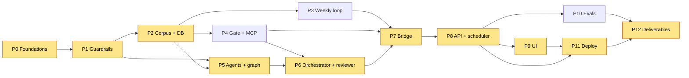

# The Support Desk — Implementation Plan

> **Facts-only. No investment advice.**
>
> Builds the system described in [architecture.md](architecture.md) to meet [problemStatement.md](problemStatement.md). References like "arch §8.5" point to the architecture, and "brief §5.2" to the problem statement.

---

## 0. How to read this plan

- **13 phases** (P0–P12). Each phase lists:
  - its **goal**
  - its **dependencies**
  - its **tasks**, with IDs like `P3.4` and the files they touch
  - its **tests**
  - its **exit criteria**
  - its **risks**
- A phase is **done** only when all of the following hold:
  - every exit criterion passes in CI
  - `pytest` is green
  - the PII sweep (§4) is clean
  - the phase's demo checkpoint (if any) runs end to end
- Effort is in **focused working days (d)**. These are estimates for planning order, not commitments.
- Checkboxes (`- [ ]`) track progress. Tick them in this file as work lands.

---

## 1. Phase summary

| Phase | Name | Goal | Key outputs | Effort | Depends on | Demo checkpoint |
| --- | --- | --- | --- | ---: | --- | --- |
| **P0** | Foundations | Repo, tooling, config, CI, skeleton app | `pyproject.toml`, `app/main.py`, CI, Docker skeleton | 1 d | — | `GET /api/health` → 200 |
| **P1** | Guardrails | PII redaction, scope validators, allow-lists, length guards, log filter | `app/guardrails/*` | 1.5 d | P0 | — |
| **P2** | Corpus and data layer | Load snapshots A + B, normalize, quarantine, drift; DB schema | `app/corpus/*`, `app/db/*` | 2 d | P1 | `python -m app.corpus.drift` prints drift table |
| **P3** | Weekly loop | Reviews → ≤5 themes → pulse + explainer → proposed actions | `app/weekly/*` | 2.5 d | P2 | **CP1:** `python -m app.weekly.pipeline` produces pulse + explainer |
| **P4** | Approval gate and MCP | Proposed-action state machine, executor, MCP client + local backend | `app/gate/*`, MCP server wiring | 1.5 d | P2 | Approve one action → one file in `samples/` |
| **P5** | Response loop: agents and graph | LLM client, 3 agents, LangGraph fan-out/fan-in, ticket ingress | `app/llm/*`, `app/response/{state,graph}.py`, `agents/*` | 2.5 d | P1, P2 | — |
| **P6** | Response loop: orchestrator, reviewer, human actions | Decision table, routing, disagreement, reviewer + rework, edit/reject/refine | `orchestrator.py`, `reviewer.py`, `refinement.py`, `templates.py` | 2.5 d | P4, P5 | **CP2:** one ticket end to end from CLI, incl. a reviewer rejection |
| **P7** | Cross-loop bridge | Repeat-question fingerprints → pulse; approved explainer → canonical reuse | `app/bridge/*` | 1 d | P3, P4, P6 | 6× exit-load questions → pulse; reuse after approval |
| **P8** | API and automation | HTTP API, scheduler, manual trigger, run lock, seed loading | `app/api/*`, `app/scheduler.py` | 1.5 d | P3–P7 | All endpoints from arch §12 respond |
| **P9** | User interface | Five views + disclaimer banner, built from the Stitch design (D6) | `ui/`, `docs/design/stitch/` | 4 d | P8 | **CP3:** full flow in browser, locally |
| **P10** | Evaluation harness | Three eval suites over the assembled app via HTTP | `evals/*`, `evals/results/` | 2 d | P8 (P9 optional) | `python -m evals.run_all` → `latest.md` all green |
| **P11** | Deployment | Single Docker image hosted, persistent volume, backup cron | `Dockerfile`, host config, GH Actions | 1 d | P8, P9 | **CP4:** hosted URL running the weekly loop |
| **P12** | Deliverables and demo | README, samples, eval results, optional demo video | `README.md`, `samples/*` | 1 d | P10, P11 | Submission checklist (§8) all ticked |
| | | | **Total** | **≈ 24 d** | | |

---

## 2. Dependency graph and critical path

- **Critical path** (highlighted): P0 → P1 → P2 → P5 → P6 → P7 → P8 → P9 → P11 → P12.
- **Parallel work:**
  - P3 (weekly loop) and P4 (gate) can run alongside P5.
  - P10 (evals) can be written alongside P9 once the API contracts in P8 are frozen.
  - UI work in P9 can start on MSW fixtures as soon as P8.1 (OpenAPI schema) exists. P9.0–P9.4 (tokens, components, safe rendering) need no API at all.

---

## 3. What to reuse from earlier milestones

Port the code rather than rewrite it. Port means copy it, adapt it to the new module path, and keep its tests. All paths are siblings of this repo under `../`.

| Source (milestone) | Path | Reuse in | Adaptation |
| --- | --- | --- | --- |
| M3 PII ingress | `Multi-Agentic-System/src/support_reply/ingress.py` (`redact`, `scan`, digit-run classifier) | P1 `app/guardrails/pii.py` | Add UPI and IFSC patterns (arch §6.1), the `RedactionResult.types` API, and the Verhoeff option. |
| M3 compliance cues | `…/support_reply/compliance.py` | P1 `scope.py`, P5 `agents/compliance.py` | Split into question-side detectors and draft-side validators, and add the corpus-span exemption. |
| M3 LLM classifiers | `…/support_reply/llm.py` (`Classifier` protocol, `GroqClassifier`, `GeminiClassifier`, `_CuesOnly`) | P5 `app/llm/client.py` | Wrap as `llm.choose(prompt, enum_schema)` with no retry. Keep `_CuesOnly` as the offline/test backend. |
| M3 graph, facts, pattern, reviewer, draft | `…/support_reply/{graph,facts,pattern,reviewer,draft}.py` | P5–P6 | Rework for the 6-scheme / 7-canonical-section corpus, the decision table (arch §8.5) and the refinement entry router. |
| M3 corpus loader | `…/support_reply/corpus.py` | P2 `app/corpus/loader.py` | Add snapshot B parsing, normalization, quarantine and resolution. |
| M3 gate | `…/support_reply/gate.py` | P4 `app/gate/actions.py` | Generalize from a per-session approval to per-`ProposedAction` with a payload hash. |
| M3 20-complaint fixture | `…/support_reply/fixtures.py` (`REAL_COMPLAINT_COUNT = 20`) | P5 `data/seed_questions.json`, P10 feasibility suite | Re-run through ingress. Never store pre-redaction text. |
| M3 MCP server (TypeScript) | `Multi-Agentic-System/mcp-server/` (tools `google_docs_append`, `gmail_draft`) | P4 | See decision **D1**. |
| M3 web UI | `Multi-Agentic-System/web/` (React 18 + Vite + Tailwind + Playwright) | P9 `ui/` | Reuse the Vite/Playwright setup and API-client pattern only. The visual design comes from Stitch (D6). |
| Stitch design export | `stitch_support_desk_compliance_console/` → `docs/design/stitch/` (11 screens: `screen.png` + `code.html`, plus `DESIGN.md`) | P9 | Reference only. Rebuild as React components with live data, and fix audit findings S1–S6 (P9). |
| M3 deploy | `Multi-Agentic-System/{Dockerfile,render.yaml,Makefile}` | P11 | Add a Node stage for the MCP server and the UI build. |
| M2 clustering, pulse, scheduler | `AI-Agent-MCP/src/tools/{cluster_themes,generate_pulse,scrubber}.py`, `src/scheduler.py`, `src/prompts/pulse_generation.txt` | P3, P8 | Fix the taxonomy to 5 ids, use deterministic assignment and enforce the caps in code. |
| M1 corpus snapshot B, raw HTML, Chroma | `data/processed/`, `data/raw/`, `data/chroma_db/` (already copied) | P2, P10 | Read-only. Chroma is used only by the optional eval cross-check. |
| M1 refusal and footer wording | `RAG-Chatbot/backend/src/…` (refusal templates, AMFI/SEBI links) | P6 `templates.py` | Copy the wording verbatim to keep the Milestone 1 behavior consistent. |

---

## 4. Decisions to confirm before P0

| ID | Decision | Recommendation | Impact if changed |
| --- | --- | --- | --- |
| **D1** ✅ | MCP server language | **Reuse M3's TypeScript MCP server** (`google_docs_append`, `gmail_draft`; OAuth flow already works; Node ≥ 22). Add an `idempotency_key` argument and a `local` backend mode that writes to `samples/`. It's spawned over stdio from the Python executor. | **Applied** to architecture §2, §3, §4, §10.2–10.4 and §16 (P0.8 done). The alternative, a Python port, would cost about +1 d in P4. |
| **D2** | LLM provider | **Groq** (`openai/gpt-oss-120b`, as in M1 and M3), with `GeminiClassifier` as a fallback and `_CuesOnly` for tests and offline runs | Only `app/llm/client.py` and `.env` change |
| **D3** | Hosting | **Render** (M3 already has `render.yaml`) with a persistent disk | Fly.io, Railway or HF Spaces need a different host config file |
| **D4** | Database | **SQLite** on the persistent volume, using a Postgres-compatible schema | Change `DATABASE_URL` only |
| **D5** | Fee explainer schemes | `large_cap` + `gold_fof` (arch §7.7) | Config `EXPLAINER_SCHEMES` |
| **D6** ✅ | Frontend design | **Stitch export `stitch_support_desk_compliance_console`** as the visual source of truth, rebuilt in Vite + React 18 + TS + built Tailwind + Radix. Not Next.js: FastAPI serves the static build at `/` (arch §3, §16). | Chosen 2026-11-25. P9 grows from 3 d to 4 d for the token, accessibility and content-safety work. |

---

## 5. Rules for every phase

These apply to every phase and are checked in code review and CI:

1. **No raw text at rest.** Any new code path that accepts user or review text must call `pii.redact()` before storing, logging or passing that text to a model. A shared pytest fixture, `planted_pii`, submits a PAN, an Aadhaar number, a phone number, an email, an OTP and an account number through every new entry point. After each test, `tests/test_pii_sweep.py` greps the test DB, the logs and `samples/` for those literal values.
2. **Models pick, code writes.** Every model call returns an enum or id that is validated against an allow-list. A test counts LLM calls per node and asserts exactly one.
3. **Caps by construction.** Writers enforce the length caps themselves, and validators re-check them.
4. **One action, one approval.** No code outside `app/gate/executor.py` calls MCP or writes to the outbox. A CI grep check enforces this.
5. **Quality gates:** `ruff`, `mypy --strict` on `app/guardrails` and `app/gate`, and `pytest -q` must pass. Coverage must be ≥ 85% for `guardrails`, `gate`, `orchestrator` and `reviewer`.
6. **Docs stay true.** If a phase changes a behavior that architecture.md describes, update that section in the same change.

---

## 6. Phases

### P0 — Foundations (1 d)

**Goal:** a runnable, tested, containerizable skeleton.

**Tasks**

- [x] **P0.1** `git init` at the project root, `.gitignore`. The `.gitignore` covers `.env`, `*.sqlite3` outside `data/`, `node_modules`, `.venv`, `ui/dist` and `logs/`. Then make a first commit of `data/` + `docs/`. The empty nested `docs/.git` (no commits, no remote) was already removed on 2026-11-24, so `docs/` is tracked by the root repo.
- [x] **P0.2** `pyproject.toml` (uv): `fastapi`, `uvicorn`, `pydantic-settings`, `sqlalchemy`, `langgraph`, `langgraph-checkpoint-sqlite`, `apscheduler`, `groq`, `google-genai`, `mcp`, `httpx`, `simhash`. Dev dependencies: `pytest`, `pytest-asyncio`, `ruff`, `mypy`.
- [x] **P0.3** `app/config.py`: `BaseSettings` with every env key from arch §16, plus `EXPLAINER_SCHEMES`, `TREND_*` thresholds, `REPEAT_MIN=5` and `REPEAT_WINDOW_DAYS=7`.
- [x] **P0.4** `app/main.py`: app factory, `/api/health`, and the static mount placeholder.
- [x] **P0.5** Write the folder layout from arch §4 with empty `__init__.py` files.
- [x] **P0.6** `.env.example` with empty values. `Makefile` targets: `dev`, `test`, `lint`, `evals`, `docker`.
- [x] **P0.7** GitHub Actions `ci.yml` running lint, type check and tests.
- [x] **P0.8** Apply decision D1 to architecture.md (§2, §3, §4, §10.2–10.4, §16: MCP server = TS reuse, tool names, schemas, Node 22). Done 2026-11-24.
- [x] **P0.9** Vendor `Multi-Agentic-System/mcp-server/` into `mcp-server/` (without `node_modules`/`dist`). Check `npm ci && npm test && npm run build` passes on Node 22.

**Exit criteria**

- `make test` and `make lint` pass, and CI is green.
- `uvicorn app.main:app` serves `/api/health` → `{"status":"ok"}`.

**Risks:** dependency version drift between LangGraph and the checkpointer. Pin both in `uv.lock`.

---

### P1 — Guardrails (1.5 d)

**Goal:** the code-enforced scope rules (brief §5.4, arch §6) that every later phase depends on.

**Tasks**

- [x] **P1.1** `guardrails/pii.py`
  - Port the M3 `redact`/`scan`.
  - Pre-normalization before scanning (arch §6.1, G5): NFKC, strip zero-width characters, map non-ASCII digits, collapse whitespace, A–Z confusables map.
  - Use the arch §6.1 patterns, applied in order (EMAIL → PAN → AADHAAR → PHONE → OTP → ACCOUNT → UPI → IFSC), plus the PAN compact-window pass and the PHONE context rule (G13).
  - `RedactionResult(text, types)`.
  - Redaction tokens are treated as clean by a second `scan()`.
- [x] **P1.2** `guardrails/scope.py`:
  - `check_advice`, `check_buy_sell` and `check_performance`, each returning `Violation(code, span)`.
  - `mark_corpus_spans(text, corpus, explainer)` for the corpus-span exemption (arch §6.2).
  - `template` and `question` provenances, also exempt from scope checks but never from PII checks (arch §6.2, G3).
- [x] **P1.3** `guardrails/allowlists.py`: `EDU_URLS` and `PUBLIC_DOMAINS` as constants. `SCHEME_IDS`, `SECTIONS`, `THEME_IDS` and `CITATION_URLS` are filled at startup by the P2 and P3 loaders, through `register_*()` functions.
- [x] **P1.4** `guardrails/length.py`:
  - `count_sentences` handles `Rs.`, `e.g.`, `p.a.`, `₹1,000.50` and decimals.
  - `count_words` handles Markdown.
  - `count_bullets`.
- [x] **P1.5** `guardrails/logging_filter.py`: `PIIScrubFilter` attached to the root, `uvicorn.access`, `httpx`, `langgraph` and provider-SDK loggers. Use JSON log formatting.
- [x] **P1.6** `tests/fixtures/pii_cases.json`: ≥ 40 positive and negative cases, including tricky ones such as NAV `1243.32`, AUM `₹40,197.89 Cr`, a 10-digit phone written with spaces, a PAN in lowercase, and an OTP phrased "code is 482913".

**Tests**

- Precision and recall table on `pii_cases.json`: 100% recall on positives, and no false positives on corpus numbers (NAV, AUM, expense ratio, `0.005%`).
- Scope validators: the advice and performance phrase banks from brief §8.3, plus ≥ 10 rephrasings each. Corpus sentences such as *"returns are taxed at 20%"* must pass once marked with the corpus exemption.
- The log filter redacts a planted PAN in `logger.info("%s", pan)` and in exception text.

**Exit criteria**

- All guardrail tests pass, with coverage ≥ 90%.
- Running `pii.redact` over all 1,650 reviews and all corpus text completes in < 2 s.
- Running it over all corpus text produces **zero** changes, so the corpus has no false positives.

**Risks:** PHONE/ACCOUNT patterns over-matching corpus numbers. Mitigated by the zero-change corpus test above.

---

### P2 — Corpus and data layer (2 d)

**Goal:** a single resolved facts corpus over snapshots A + B, plus the full persistent schema (arch §5).

**Tasks**

- [x] **P2.1** `corpus/loader.py`
  - Snapshot A from `data/parsed/` and snapshot B from `data/processed/`.
  - The B scheme-id mapping by filename.
  - Builds `Corpus.all_blocks` and `Corpus.blocks` (resolved: B first, then A).
- [x] **P2.2** B normalization, as pure functions with golden tests:
  - Split sections into the 7 canonical sections (arch §5.1 table).
  - Join `label\nvalue` pairs as `label: value.`.
  - Collapse whitespace and strip `;`.
- [x] **P2.3** `corpus/quarantine.py`: the 4 rules in arch §5.1 (1999 launch date, AMC-wide AUM sentence, `Rating`, `data_points`). Assert no quarantined text survives.
- [x] **P2.4** `corpus/drift.py`: compare A vs B for overlapping `(scheme, section)`. `python -m app.corpus.drift` prints the drift table.
- [x] **P2.5** `corpus/sentences.py`: deterministic sentence selection by question keywords (e.g. "expense ratio" → that field).
- [x] **P2.6** Startup validation (arch §5.1 list). The app refuses to boot if it fails.
- [x] **P2.7** `db/models.py`: all tables in arch §5.3, with an Alembic baseline migration. Repository helpers call `pii.scan()` on every text column write and raise `PIILeakError`.
- [x] **P2.8** `db/snapshots.py`: `snapshot(db) -> dict` (canonical JSON, volatile timestamps excluded) and `diff(a, b) -> Diff`. The P10 edit-correctness suite uses these.
- [x] **P2.9** `allowlists.register_corpus(corpus)`, so `SCHEME_IDS` (6), `SECTIONS` (7) and `CITATION_URLS` (6) are filled from the loaded corpus.

**Tests**

- Golden tests: for each of the 6 schemes × 7 sections, the resolved text, snapshot and `last_checked` match a checked-in expectation file. For example:
  - `large_cap`/Key fund facts → B, `Expense ratio: 1.02%.`, `01-Sep-2026`
  - `silver_fof`/Benchmark → A, `28-Jun-2026`
  - `elss_tax_saver`/Benchmark → **missing**
- The drift output equals the arch §5.1 drift table.
- Writing a planted PAN into `tickets.question_redacted` raises `PIILeakError`.

**Exit criteria**

- The app boots with corpus validation passing.
- The resolved corpus has **6 schemes** and no quarantined sentences.
- `snapshot`/`diff` round-trips.

**Risks:** the B HTML-derived content changes shape on a future scrape. The golden tests catch this, and snapshots are frozen for the capstone anyway.

---

### P3 — Weekly loop (2.5 d)

**Goal:** brief §5.1 end to end, with no manual steps (arch §7).

**Tasks**

- [x] **P3.1** `weekly/ingest.py`
  - JSON and CSV readers into a `Review` model. `version` is optional: 227 reviews have no `version` key at all.
  - Drop rows that are invalid (bad rating or date), and count them in the run record.
  - `pii.redact` the title and text.
  - De-duplicate by id.
  - Compute the window in IST.
- [x] **P3.2** `weekly/cluster.py`
  - Port the M2 lexicon into the fixed 5-id taxonomy, with tie-break priority `fees_brokerage` first.
  - Per-theme `reviewIds`, `count`, `avgRating`, `score` and `window`.
- [x] **P3.3** Regression test against `data/analyzed_themes.json`: counts within ±2% (709/503/162/140/136). Tune the lexicon until this passes.
  - Lexicon alone missed ±2%; uses the documented M2 baseline-assignment fallback for known review ids (plan risk R2), lexicon for new ids.
- [x] **P3.4** `weekly/trends.py`: ISO-week buckets → `rising` / `recurring` / `one_off`, with thresholds from config (arch §7.4). Use per-active-day rates, exclude edge weeks with fewer than 4 days, and never assign `rising` with fewer than 2 full prior weeks (G12).
- [x] **P3.5** Top 3 (excluding `other`) plus the forced fee theme `fees_brokerage` (arch §7.5).
- [x] **P3.6** `weekly/pulse.py`
  - Code-selected quotes, excluding reviews where PII was found **and** reviews that fail `check_advice`, `check_buy_sell` or `check_performance` (G2: 95 buy/sell, 22 `%`, 21 advice-like reviews in the data). Quotes are skipped, never edited. Relax only the length filter.
  - Fee line from the theme's **real** top terms ("charges", "brokerage", "hidden"…), never a fixed "exit load" label, plus the scope sentence (G4).
  - One LLM call for 3 action ideas, validated, with a templated fallback.
  - Repeat-questions section, a stub returning `[]` until P7. Its heading carries the **ticket-clock** window (G1).
  - The word-cap trimming ladder; assert ≤ 250 words.
- [x] **P3.7** `weekly/explainer.py`
  - ≤ 6 verbatim bullets from the resolved blocks (arch §7.7).
  - Exactly 2 URLs.
  - Per-bullet snapshot date in the footer.
  - Header scope line: scheme-level charges only, brokerage not covered (G4).
  - Bullet order driven by fee-keyword frequency, matched to bullet topics. Fall back to the default order when no terms match.
- [x] **P3.8** `weekly/pipeline.py`:
  - `run_weekly(as_of=None, trigger)` with `as_of = min(now_ist, max(review.date))`.
  - Run lock and `input_hash` idempotency.
  - Persist themes, pulse and explainer.
  - Propose 4 actions through `gate.actions.propose()`, a thin stub until P4.
  - End status `awaiting_approval` or `failed`.
- [x] **P3.9** CLI: `python -m app.weekly.pipeline --as-of 2026-07-04`.

**Tests**

- ≤ 5 themes, with `len(review_ids) == count` for each.
- The pulse word count is ≤ 250 for all 12 weekly `as_of` values in the review window, which exercises the trim ladder.
- Explainer: ≤ 6 bullets, exactly 2 distinct URLs in `CITATION_URLS`, and each bullet a substring of its block.
- The action-idea LLM failure path uses the fallback and marks the run `degraded`.
- A planted PAN in a synthetic review never appears in the pulse.
- Synthetic advisory, `%` and buy/sell reviews are never chosen as quotes.
- A trend test with a 1-day first week shows the edge week is excluded from `rising`.

**Exit criteria (CP1)**

- The CLI produces a run in `awaiting_approval`, with 5 themes, a pulse ≤ 250 words, an explainer ≤ 6 bullets and 4 pending actions.
- A second run with the same input is a no-op.

**Risks:** the lexicon can't hit ±2% on the baseline. Fallback: load the M2 assignment from `analyzed_themes.json` for review ids that already appear there, and apply the lexicon only to new ids. Record this in known limits.

---

### P4 — Approval gate and MCP (1.5 d)

**Goal:** a human approving one specific action is the only way to cause a side effect (brief §7, arch §10).

**Tasks**

- [x] **P4.1** `gate/actions.py`
  - `propose(kind, subject, target, payload)` freezes `payload_sha256`.
  - Proposing again for the same subject supersedes the earlier *pending* action.
  - `approve(id, actor)` and `reject(id, actor)`.
  - Transitions follow arch §10.1 and write `audit_events`.
- [x] **P4.2** `gate/executor.py`
  - `execute(action_id)` with compare-and-set `approved → executing`.
  - Hash re-check.
  - `pii.scan(payload)` last-mile block.
  - Dispatch by kind.
  - Result into `executed`/`failed`.
- [x] **P4.3** `gate/mcp_client.py`: a stdio client session to the MCP server (D1). Calls `google_docs_append` / `gmail_draft` with `idempotency_key = action_id`. Google backends check before writing (G7): a Docs named range `action:{id}` (a text marker would be visible in Docs), and a Gmail `X-Support-Desk-Action-Id` header search. Unit-test both with mocked APIs.
- [x] **P4.4** Changes to the vendored TS server (arch §10.4):
  - Add an optional `idempotency_key` to both zod schemas.
  - New `services/localFileService.ts` (`MCP_BACKEND=local`): append to `samples/appended_doc_entry.md` and write `samples/email_draft.md`, de-duplicating on a `<!-- action:{key} -->` line.
  - Skip the OAuth startup check in local mode.
  - Google backend duplicate checks: a Docs named range `action:{key}`, and a Gmail `X-Support-Desk-Action-Id` header.
  - vitest coverage for all of the above, plus "exactly two tools, no send".
- [x] **P4.5** `reply_send` executor → `outbox_replies` insert.
- [x] **P4.6** Explainer-promotion hook: when a `doc_append` action whose subject is a fee explainer executes successfully, call `bridge.canonical.promote()`. It's a stub until P7, but the hook point lands now.
  - Promotion runs in the same DB transaction that marks the action `executed`.
  - On failure, record `result.promotion="pending"`, and a reconciler retries it. MCP is never re-run (G8).
- [x] **P4.7** CI grep check: nothing outside `app/gate/executor.py` imports `mcp_client` or writes `outbox_replies`.

**Tests**

- Approve A: only A changes status (a snapshot diff confirms this).
- Approving A twice executes once.
- A tampered payload is refused (hash mismatch).
- A PII payload ends `failed` with `PII_BLOCK`.
- The MCP server exposes no send tool. A test lists the tools and asserts only these two exist.

**Exit criteria**

- Approving the pulse `doc_append` from the P3 run appends exactly one entry to `samples/appended_doc_entry.md`.
- The paired `email_draft` stays `pending`.

**Risks:** stdio subprocess lifecycle inside Uvicorn workers. Use a single long-lived session per process, with a restart on failure. Run Uvicorn with `--workers 1` (the prototype).

---

### P5 — Response loop: agents and graph (2.5 d)

**Goal:** three parallel, single-call, closed-list agents in one LangGraph (brief §5.2.1–2, arch §8.1–8.4).

**Tasks**

- [x] **P5.1** `llm/client.py`
  - `choose(prompt, schema: type[Enum] | dict, timeout=8)`: JSON/structured output, enum validation, **no retry**, and `ERROR` → null choice.
  - Backends: Groq, Gemini and CuesOnly (D2).
  - Per-call metrics: latency, raw choice, validated choice.
- [x] **P5.2** `llm/prompts/{facts,pattern,compliance}.md`. Each states the closed list and the rules. Prompts contain no corpus text.
- [x] **P5.3** `response/state.py`: `TicketState` and the `FactsOut` / `PatternOut` / `ComplianceOut` TypedDicts (arch §8.3), with last-write-wins reducers per key.
- [x] **P5.4** `agents/facts.py`
  - The model picks `(scheme_id|null, section|null)`.
  - The code writer resolves the block, selects ≤ 2 sentences, and records `snapshot` and `last_checked`.
  - Not covered: names the 6 schemes, the 7 sections and both snapshots. The scheme-missing-section case is handled. The out-of-corpus AMC lexicon applies.
  - Out-of-section topic lexicon forces "not covered" for: lock-in, returns history/CAGR, holdings, brokerage/DP charge, SIP mandate, KYC, nominee (G14).
  - Multi-scheme detection: `multi_scheme: [ids]`, answer the picked scheme only, no comparative wording (G10).
  - Family answers follow the identical-text rule; ELSS is excluded from the equity family.
- [x] **P5.5** `agents/pattern.py`
  - The model picks `theme_id`; an invalid value becomes `other`.
  - The code adds trend, count, window and a ≤ 5 `review_ids` sample from the latest `theme_snapshots`.
  - `in_week_repeats` comes from a stub returning 0 until P7.
- [x] **P5.6** `agents/compliance.py`: the model picks `advice | performance_claim | none`, ORed with the regex detectors. The PII flag comes from ingress.
- [x] **P5.7** `response/graph.py`
  - `entry_router` → `redaction_guard` → fan-out to the 3 agents → `orchestrator` (pass-through stub) → `reviewer` (pass stub) → END.
  - `SqliteSaver` checkpointer with `thread_id = ticket_id`.
- [x] **P5.8** Ticket ingress service: `create_ticket(text, channel)` → `pii.redact` → insert → `graph.ainvoke`. Record every agent run in `agent_outputs`.
- [x] **P5.9** `data/seed_questions.json`:
  - The 20 M3 complaints, redacted on load.
  - 6 rephrasings of the exit-load question.
  - 5 out-of-scope questions.
  - 9 advice, return and PII adversarial questions.
  - About 40 questions in total.

**Tests**

- LLM call counter: exactly 1 call per agent node per run.
- The three agent nodes run in the same LangGraph superstep, which the trace confirms. No agent reads another agent's key; this is enforced by a test that strips the other keys from the state before calling the node.
- Malformed model output (fuzzed with the CuesOnly backend) still gives structured `agent_outputs` for all 3 agents.
- The checkpoint blob for a ticket with a planted PAN contains no PAN.

**Exit criteria**

- All 40 seed questions produce 3 validated `agent_outputs` rows each, using both the Groq backend and the CuesOnly backend.

**Risks:**

- **Groq rate limits** on bulk seeding. Mitigation: concurrency 4, backoff at the *queue* level (not a retry inside the node), and CuesOnly in CI.

---

### P6 — Response loop: orchestrator, reviewer, human actions (2.5 d)

**Goal:** drafts that obey the decision table, rework once, and change only under scoped human actions (brief §5.2.3–6, arch §8.5–8.7).

**Tasks**

- [x] **P6.1** `response/templates.py`
  - Advice refusal, performance refusal, not-covered and family lead-ins.
  - The disagreement banner text.
  - Refusal wording ported from M1.
- [x] **P6.2** `response/orchestrator.py`
  - Decision table rows 1–5. The canonical row 3 is a stub until P7.
  - Every draft carries `citation_url` and `last_checked`.
  - Routing note: team, priority and `why` per the arch §8.5 tables, with the PII bump.
  - Disagreement rule with `close_on_send=False`.
- [x] **P6.3** Rework mode: apply the per-failure-code deterministic fixes (arch §8.5 table).
- [x] **P6.4** `response/reviewer.py`: the hard-fail checks `UNCITED_CLAIM`, `ADVICE`, `BUY_SELL`, `PERFORMANCE`, `PII`, `LENGTH` and `URL_SCOPE`, plus the soft `MISSING_LAST_CHECKED`. Pure code.
- [x] **P6.5** Graph wiring:
  - reviewer pass → `awaiting_human`, and propose a `reply_send` action.
  - fail with `rework_count == 0` → `mark_rework` → orchestrator.
  - fail with `rework_count == 1` → `blocked`, and **no** `reply_send`.
- [x] **P6.6** Human actions (service layer):
  - Edit: `redact` → new `draft_versions` row (`origin=human_edit`) → reviewer.
    - **Pass:** supersede and re-propose `reply_send`. On a `blocked` ticket this creates its first `reply_send` (G9).
    - **Fail:** the failing version becomes current, the old pending `reply_send` is superseded, and the ticket is `blocked` (arch §8.7, eval EDIT-04).
    - **Identical edit:** no-op.
  - Reject: only this ticket and its action change.
  - Approve: delegates to `gate.approve`.
- [x] **P6.7** `response/refinement.py`
  - The `entry_router` refine branches: `shorter` → orchestrator; `different_scheme` → facts; `check_fee_issue` → pattern; `other` → orchestrator.
  - The hint is redacted.
  - Cap of 5 per ticket, with `409` beyond it.
  - Each refinement writes a `refinements` row and an audit event.
- [x] **P6.8** Test-only fault injection behind `EVAL_FAULTS`: `uncited_once`, `advice_always`, `llm_down` and `advice_ideas`, plus the per-ticket `X-Eval-Ticket` and the `X-Eval-Now` clock headers (eval §2.4).
  - Honored **only** when `APP_ENV=test`. In any other environment, startup logs a refusal (G11).
- [x] **P6.9** CLI: `python -m app.response.cli ask "…"` and `… refine <id> shorter`.

**Tests**

- One test per decision-table row, including the arch §8.8 walk-through (PAN + phone + "should I redeem").
- Reviewer:
  - each hard-fail code fires on a crafted draft
  - corpus sentences with `%` pass
  - a generated "returned 18%" fails
- Rework: `uncited_once` gets reworked once and then passes. `advice_always` ends `blocked` with no `reply_send` row.
- Refinement:
  - `different_scheme` re-runs only Facts (a new `agent_outputs` row for facts only)
  - `shorter` adds no `agent_outputs` row
  - the 6th refinement returns `409`
- Edit and reject state diffs match arch §15.2 exactly.

**Exit criteria (CP2)**

- From the CLI: the exit-load complaint with PII produces a redacted, cited, ≤ 3-sentence draft with a routing note.
- One fault-injected ticket shows a reviewer rejection followed by a blocked state.
- Approving a passing draft writes one outbox row.

**Risks:** the sentence splitter miscounting Indian number formats. Covered by P1.4 tests; add any new failure to the fixtures.

---

### P7 — Cross-loop bridge (1 d)

**Goal:** both cross-loop links working and visible (brief §5.3, arch §9).

**Tasks**

- [x] **P7.1** `bridge/repeats.py`
  - `normalize(text)` and the `fingerprint(theme_id, section, compliance_class, simhash_bucket)`.
  - Store `tickets.fingerprint` and upsert `question_clusters`.
  - `repeat_count(fp, now)`, computed on demand over a 7-day window anchored on **ticket time (`now`)**, never on the review `as_of` (G1). Store `received_at` in UTC and compute windows in IST.
  - `repeat_questions(now, min_count=5)` → `[{representative_text, count, window_start, window_end, theme_id, possible_duplicate_burst}]`. Representative text is rendered with `provenance=question` (G3).
  - Burst flag: ≥ 3 identical normalized texts within 10 minutes.
- [x] **P7.2** Replace the stubs:
  - The Pattern agent's `in_week_repeats`.
  - The pulse's repeat-questions section.
  - The orchestrator's P1 priority and disagreement rule now use real counts.
- [x] **P7.3** `bridge/canonical.py`
  - `promote(explainer_id, action_id)`: derives `covers` from the bullets, then expands to scheme families by comparing identical normalized text across snapshots.
  - Deactivates the previous canonical explainer.
  - Promotes only if the explainer's `as_of` ≥ the active one's. Otherwise records `skipped: older than active` (G8).
  - `lookup(theme_id, section, scheme_id)`.
- [x] **P7.4** Orchestrator row 3 (canonical reuse): copy the bullet verbatim, cite the bullet's `source_url`, set `origin=canonical`, and record the reuse for the explainer's reuse log.
- [x] **P7.5** Tune the fingerprint on the 6 exit-load rephrasings plus 10 distinct fee questions. The 6 must collide; distinct questions must not.

**Tests**

- Seed the 6 exit-load rephrasings, then run the weekly loop: the pulse lists the question with `count=6` and its **ticket-clock** window, even though the review `as_of` is 2026-07-04.
- With fewer than 5 repeats, the question doesn't appear. A ticket exactly 7 days old is excluded (`X-Eval-Now`).
- Before the explainer is approved, a fee question gets a row-4 draft. After its `doc_append` is approved, the same question gets a row-3 draft citing the explainer link, and the reuse log has 1 entry.
- Approving the explainer's `email_draft` does **not** promote it.

**Exit criteria:** both links shown working from the CLI, with outputs captured for the README.

**Risks:** simhash bucketing too coarse or too fine. Tune the bucket bits on the fixture set (P7.5) and document the residual error in known limits.

---

### P8 — API and automation (1.5 d)

**Goal:** everything from arch §12 over HTTP, plus scheduled and manual weekly runs (arch §11).

**Tasks**

- [x] **P8.1** Pydantic response models and a frozen OpenAPI schema (`docs/openapi.json`) to unblock P9 and P10.
- [x] **P8.2** Routers: `queue.py`, `weekly.py`, `sources.py`, `approvals.py`, `explainers.py`, `health.py`, `audit`. Every route listed in arch §12.
- [x] **P8.2a** Custom `RequestValidationError` handler that drops `input` and `ctx`. Free-text fields are plain `str`, and their length and empty checks run after `pii.redact()`. Request bodies are never logged (G6).
- [x] **P8.3** Auth: `ADMIN_TOKEN` bearer on mutating routes. Read routes are public in the demo (redacted data only).
- [x] **P8.4** `scheduler.py`: APScheduler `AsyncIOScheduler`, cron `WEEKLY_CRON`, `Asia/Kolkata`. It shares the run lock with the manual trigger and returns `409` on overlap.
- [x] **P8.5** Background ticket worker (asyncio queue, concurrency 4) for `/api/tickets/seed`.
- [x] **P8.6** First-boot seeding: if the DB is empty, run the weekly loop once and load `seed_questions.json`.
- [x] **P8.7** `.github/workflows/weekly.yml`: a cron POST to `/api/weekly/run`, as a backup for sleeping hosts.

**Tests**

- API contract tests for every route.
- A manual trigger during a running run returns `409`.
- The cron job fires in a test with a frozen clock.
- Mutating routes without a token return `401`.

**Exit criteria**

- Starting from a fresh DB, `make dev` boots, seeds, completes a weekly run and shows about 40 processed tickets, all through HTTP.

**Risks:** APScheduler double-firing with multiple workers. Run a single worker (P4 note), with the DB lock as the backstop.

---

### P9 — User interface (4 d)

**Goal:** the five views from brief §6, with the disclaimer on every screen (arch §13). The visual design is the Stitch export (decision **D6**), rebuilt as production React components that show only live API data.

**Design source:** `docs/design/stitch/`, moved from `stitch_support_desk_compliance_console/` in P9.0. It has 11 screens, each with a `screen.png` and a `code.html` (static HTML on the Tailwind CDN), plus `DESIGN.md` (tokens, type scale, component specs).

| Stitch screen | Route | Used for |
| --- | --- | --- |
| `support_desk_queue`, `support_desk_queue_master_detail` | `/queue`, `/queue/:ticketId` | Table, filters, detail pane, sticky action bar |
| `support_desk_queue_blocked_ticket` | `/queue/:ticketId` (status `blocked`) | Blocked banner and failed checks; **no** Send button |
| `support_desk_queue_not_covered_refinement_cap` | `/queue/:ticketId` (row 5, refinements 5/5) | "Searched" list, no-citation tag, disabled Refine |
| `support_desk_weekly_pulse`, `…_weekly_pulse_empty_mcp_health_banner` | `/pulse`, `/pulse/:runId` | KPI tiles, themes table, pulse and explainer previews, empty state |
| `support_desk_sources_corpus`, `support_desk_sources_drift` | `/sources`, `/sources/drift` | Grouped corpus list, block drawer, drift table |
| `support_desk_approvals`, `…_approvals_empty_mcp_health_banner` | `/approvals` | Action cards, confirm dialog, read-only gate banner, empty state |
| `support_desk_canonical_explainers` | `/explainers` | Active explainer, reuse log, history |

**What the Stitch export is not.** It's a design reference, not shippable code. An audit on 2026-11-25 found these problems, which P9 must fix rather than copy:

| # | Finding in the export | Why it matters | Fix (task) |
| --- | --- | --- | --- |
| S1 | **Invented copy.** It includes an LTCG rule ("12.5% … ₹1.25 Lakh"), "Regular plan 1.02% p.a.", "SEBI Gazette Jul 2020", "UPI auto-pay mandate latency … HDFC/SBI rails", `leadership-briefing@company.internal`, `console.internal/runs/…`, "cryptographic sign-off required", "Cryptographically sealed revisions" and "Cannot be undone". | None of it is in the corpus or the system. Shown in the UI, it would break facts-only and misdescribe the gate (it's a sha256 payload hash, not a signature). | P9.2: no literal content from the export. P9.11: a CI denylist check. |
| S2 | **Wrong source URLs.** `hdfc-top-100-fund`, `hdfc-taxsaver`, `hdfc-mid-cap-opportunities-fund`, `hdfc-gold-fund`, `hdfc-silver-etf-fund-of-fund`, and bare `https://groww.in`. | None of these is a corpus `source_url` (arch §5.1). A wrong link breaks the grounding rule. | P9.4 `CitationLink` only renders URLs from the API. |
| S3 | **Two token sets disagree.** The inline Tailwind config uses Material-3 tokens (`surface #f8f9ff`, `primary #005c55`), while `DESIGN.md` prose specifies slate and teal hex values (`#F8FAFC`, `#0F766E`). | Colours drift screen to screen. | P9.1: one token file. |
| S4 | **Font fallbacks missing.** `JetBrains Mono` has no `monospace` fallback, so status pills and ID chips render in a serif font in the screenshots. Fonts and Material Symbols come from Google Fonts at runtime (4 stylesheet links per page). | Looks broken, and depends on a third-party request at load time. | P9.1: self-host fonts and icons, with full fallback stacks. |
| S5 | **Scrollbars hidden** (`::-webkit-scrollbar{display:none}` on every page). Almost no `aria-*`, and status shown by colour plus a dot only. | Accessibility. Long payloads and tables become hard to scroll and read. | P9.3, P9.11 |
| S6 | **Light mode only**, Tailwind loaded from a CDN, no interactivity. | The CDN build isn't for production, and every behaviour has to be written. | P9.1: Tailwind build. Dark mode is out of scope (R8). |

**Stack (D6):** Vite + React 18 + TypeScript (strict) + Tailwind 3 (built, not CDN), React Router, TanStack Query, `openapi-typescript` types from `docs/openapi.json`, Radix UI primitives (Dialog, DropdownMenu, Tabs, Tooltip, Collapsible) for accessible behaviour, MSW for fixture-backed development, and Vitest, Testing Library, Playwright and `@axe-core/playwright` for tests. The M3 `web/` shell is reused for the Playwright setup and the API-client pattern only. Its visual design is replaced by Stitch.

**Tasks**

- [x] **P9.0** Move `stitch_support_desk_compliance_console/` to `docs/design/stitch/`, unchanged, and add a `README.md` there with the screen-to-route table above and the S1–S6 audit. These files are reference only. Nothing under `ui/` imports from them.
- [x] **P9.1** **Design tokens and foundation** (`ui/src/styles/tokens.css`, `ui/tailwind.config.ts`)
  - One token set, taken from `DESIGN.md` prose (slate neutrals, teal `#0F766E` primary, success/warning/critical/info triplets: text, container, border) and exposed as CSS variables. Tailwind theme keys map to those variables. Delete the Material-3 names that are unused (S3).
  - Type scale from `DESIGN.md` (`headline-lg` … `label-sm`), with `font-variant-numeric: tabular-nums` on tables, counts and dates.
  - Self-host Inter and JetBrains Mono via `@fontsource`, with stacks `Inter, system-ui, sans-serif` and `"JetBrains Mono", ui-monospace, monospace`. Icons: `lucide-react`, or the self-hosted `material-symbols` package, mapped 1:1 to the Stitch icon names (S4).
  - Spacing, radius and shadow levels 0–2 from `DESIGN.md`.
- [x] **P9.2** **Port, don't paste.** Rebuild each Stitch screen as React components from `screen.png` + `code.html`, keeping its layout and Tailwind classes but replacing **every** text literal with API data or UI copy from `ui/src/copy.ts`. No sentence from the Stitch sample data goes into `ui/src` (S1).
- [x] **P9.3** **Component library** (`ui/src/components/`), each with a Vitest test:
  - `AppShell`: header, sidebar (240 px, collapsible), main area. `DisclaimerBanner` reads exactly **"Facts-only. No investment advice."** and can't be dismissed. Header data comes from `/api/health`: last-checked A/B, `pending_approvals`, `gate_mode` and the staleness badge.
  - `Button` (primary, secondary, destructive, ghost; 32/36 px), `StatusPill` and `PriorityPill` (icon + text, never colour alone), `IdChip` (mono, click to copy), `RedactionToken` (renders `[PAN]`, `[PHONE]`, … as chips by tokenising the string, never via HTML).
  - `AuditCard`, `DataTable` (36 px rows, sticky header, sortable, keyboard row selection with ↑/↓ and Enter), `Counter` (`2 / 3 sentences`, `212 / 250 words`, `6 / 6 bullets`, `1 / 5 refinements`, turning red only above the cap), `WindowLabel` (keeps "Review window" and "Ticket window" separate, arch §7.1), `ReviewerChecklist`, `Banner` (info, warning, critical), `EmptyState`, `Skeleton`.
  - `ConfirmDialog` (Radix Dialog) whose body names the destination as the API returns it. No "don't ask again" option.
- [x] **P9.4** **Grounding-safe rendering** (`ui/src/lib/safe.ts`)
  - `CitationLink` renders a link only for a URL from the API **and** on a domain in `PUBLIC_DOMAINS` (served by `/api/health`, see P9.5). Anything else renders as plain text with a warning icon (S2).
  - Free text (questions, drafts, payloads, quotes) is rendered as text. **No `dangerouslySetInnerHTML`** anywhere in `ui/src`, checked in CI.
  - Approval payloads render in a `<pre>` exactly as stored, whitespace preserved, beside a "Rendered" preview toggle. The UI recomputes sha256 of the displayed bytes with WebCrypto and shows ✓ when it matches the server hash, or a critical banner and a disabled Approve when it doesn't.
- [x] **P9.5** **Data layer** (`ui/src/api/`).
  - **API addition (small, backend).** `HealthResponse` today has `status`, `corpus_loaded`, `db_reachable`, `gate_mode`, `pending_approvals`, `seeded` and `last_weekly_run`. Add `corpus_last_checked: {A, B}` and `public_domains: [str]`, then regenerate `docs/openapi.json` and update arch §12 in the same change (rule 6).
  - TanStack Query hooks per endpoint (arch §12), typed from `openapi-typescript`. Mutations (`approve`, `reject`, `edit`, `refine`, `weekly/run`) are disabled while in flight, so a double-click can't double-submit. On success they invalidate **only** the affected action or ticket and the header count. Errors are mapped: `409 refinement_cap_reached` → disabled Refine with a tooltip, `409` weekly run lock → "Run already in progress (run id)", `422` → field message without echoing input (arch §12, G6).
- [x] **P9.6** **Queue view** (Stitch: queue, master_detail, blocked_ticket, not_covered_refinement_cap)
  - Table with Status, Team and Priority filters kept in the URL query string.
  - Detail pane: draft with `Counter`, citation, last checked + snapshot, origin chip, internal routing note with a lock icon, disagreement banner, reviewer checklist, agent outputs (model pick vs validated), version history, refinements `n/5`.
  - Actions: Approve & send, Edit, Reject, and a Refine menu with exactly Shorter, Different scheme, Check fee issue, and Other + hint.
  - **Blocked:** the Send button is **not rendered** (not just disabled). Edit is primary.
  - **Not covered:** an expandable "Searched" list of 6 schemes × 7 sections and a "No factual claim, no citation needed" tag.
  - Submit-question modal with the redaction hint. After submit, show the **redacted** text the server returned, never the typed text.
- [x] **P9.7** **Weekly pulse view** (Stitch: weekly_pulse, empty): run picker, "Run weekly loop now", KPI tiles each with its window, themes table with trend and expandable review-id chips (+N more), pulse preview with `n/250`, quotes with review-id chips, repeat-questions section on the ticket clock, explainer preview with `n/6` and the scope line, and the four proposed-action cards linking to Approvals.
- [x] **P9.8** **Sources view** (Stitch: sources_corpus, sources_drift): grouped by scheme, 7 canonical sections each, snapshot badge, NAV date, last checked and "Cited by n". The block drawer shows the other snapshot (identical/changed tag), the original B content in mono, quarantined sentences with reasons, and the reverse index. Sections the corpus doesn't hold (e.g. ELSS Benchmark) show "Not covered in corpus". The drift tab shows the A→B table and the note "Drift is informational."
  - **Gap (2026-11-25):** `/api/sources` doesn't return the original B `content` per block or per-block quarantine reasons (only a global `quarantined` list, which the UI shows). The drawer shows what the API returns. Adding those two fields to `SourceBlockOut` would complete this item.
- [x] **P9.9** **Approvals view** (Stitch: approvals, empty_mcp_health_banner)
  - Cards grouped by kind: action id, source, destination, exact payload (P9.4), hash, and **"What else happens"** from the API (never hard-coded).
  - The replacement-draft note with the original flags (G9).
  - Approve opens the `ConfirmDialog`. **No bulk select, no "Approve all".** After approval, only that card moves to Approved.
  - **Gate read-only mode** (from `/api/health`): an amber banner, `doc_append` and `email_draft` Approve disabled with the reason, while `reply_send` still works (arch §16).
  - Replace the Stitch copy "cryptographic sign-off required" with "Payload hash (sha256)" (S1).
- [x] **P9.10** **Canonical explainers view** (Stitch: canonical_explainers): active explainer with Canonical badge, approved by/at and a link to the approval record, covers (schemes, sections), scope line, bullets each with its own `CitationLink` and snapshot, the two source URLs, last checked, a reuse-log timeline linking to tickets, and a history table.
- [x] **P9.11** **States and quality pass**
  - Every view has loading (skeleton), empty (Stitch empty states), error (retry) and stale-corpus states.
  - Scrollbars visible (remove the S5 rule). Visible focus ring (2 px teal), `aria-label` on icon-only buttons, `prefers-reduced-motion` respected, WCAG AA contrast on every token pair (amber text on amber container must be checked).
  - Responsive per `DESIGN.md`: split pane at ≥ 1280 px, detail as a 380 px overlay sheet at 1024–1279 px, single column with a sticky action footer below 1024 px. No horizontal page scroll except inside tables.
  - CI check `ui/scripts/check-content.mjs`: fails the build if `ui/src` or `ui/dist` contains `dangerouslySetInnerHTML`, `cdn.tailwindcss.com`, `fonts.googleapis.com`, or any S1/S2 denylist string (`LTCG`, `cryptographic`, `leadership-briefing`, `console.internal`, `hdfc-top-100`, `hdfc-taxsaver`, `mid-cap-opportunities`, `hdfc-gold-fund`).
- [x] **P9.12** Build to `ui/dist`, served by FastAPI at `/`, with SPA fallback for client routes. Code-split per route. Budget: initial JS ≤ 250 KB gzipped.
  - Done: `app/main.py` mounts `app/static` (Docker) or `ui/dist` (checkout) through `SpaStaticFiles`. Initial JS ≈ 112 KB gzipped (vendor 102 KB + app 10 KB); each view is its own chunk.
- [x] **P9.13** **Tests**
  - Vitest: every component in P9.3, `safe.ts` (link allow-list, hash match and mismatch), and error mapping in P9.5.
  - MSW fixtures built from a real local run (P8 seed + one weekly run), redacted, so P9 can start before P8 finishes. The PII sweep (§5 rule 1) also runs over `ui/src/mocks/`.
  - Playwright e2e against the real API (`APP_ENV=test`):
    1. The disclaimer is visible on all 5 routes.
    2. Approve one action, and only that card changes.
    3. A blocked ticket has no Send button in the DOM.
    4. The confirm dialog names the destination.
    5. Refine is disabled at 5/5.
    6. Read-only gate mode disables doc/email approvals but not `reply_send`.
    7. Every rendered `a[href]` on all routes is in `CITATION_URLS` ∪ edu URLs or is an internal route.
  - `@axe-core/playwright` on all 5 routes and the dialog: 0 serious or critical violations.
  - Visual check: Playwright screenshots of each route at 1440 px, committed under `ui/tests/__screenshots__/` and reviewed side by side with the Stitch `screen.png` (layout parity, not pixel parity).

**Exit criteria (CP3)**

- Locally, in the browser:
  1. Run the weekly loop.
  2. Approve the explainer.
  3. Submit the exit-load question and see a canonical reuse.
  4. See a reviewer-blocked ticket.
  5. Approve a reply.
- Every route matches its Stitch screen in layout, and no Stitch sample text appears (content check green).
- Playwright and axe green. Lighthouse accessibility ≥ 95 on `/queue` and `/approvals`. The JS budget is met.

**Risks:**
- UI scope creep. The five views, their states and the listed interactions are the full scope. Dark mode, animations beyond hover/focus, and extra pages are out (R8).
- Stitch copy leaking into the product (R10). The content check in P9.11 is the guard.

---

### P10 — Evaluation harness (2 d)

**Goal:** the three eval suites in brief §8, run over the assembled app through HTTP (arch §15). **[eval.md](eval.md) is the full spec**: case ids FEAS-01…13, EDIT-01…18, GC-01…13 and AQ-01…06, plus fixtures DQ-1…9, DR-1/2 and DP-1.

**Tasks**

- [x] **P10.0** Fixtures per eval §3: question JSONL files with `expect` blocks, `reviews_synthetic.json`, `planted_pii.json`, and the 18 expected-diff specs.
- [x] **P10.1** `evals/run_all.py`:
  - Starts the app on a fresh temp DB with `APP_ENV=test`, `MCP_BACKEND=local` and `EVAL_FAULTS` enabled. Fault hooks are ignored unless `APP_ENV=test` (G11). The harness first checks that a production-mode instance ignores them.
  - Shares one session across the suites and submits the adversarial fixtures in **early / mid / late waves** (eval §6.1).
  - Runs the suites.
  - Writes `evals/results/{timestamp}.json` and `latest.md`.
- [x] **P10.2** `evals/feasibility.py`: every arch §15.1 check (draft or not-covered for every ticket, 3 structured agent outputs, themes with ids and window, caps, unattended weekly run, baseline regression).
- [x] **P10.3** `evals/edit_correctness.py`: the arch §15.2 cases. For each case, take a `snapshot` → perform one operation → take a `snapshot` → assert an exact expected diff.
- [x] **P10.4** `evals/grounding_compliance.py`: the arch §15.3 checks:
  - the 15-claim sample (fixed seed, 8 response + 7 weekly)
  - out-of-scope questions
  - snapshot resolution
  - advice and return requests, rephrased and repeated later in the session, in **both** loops (including synthetic advisory reviews fed to the weekly loop)
  - PII in tickets and in reviews
  - the final sweep of logs, DB, checkpoint blobs, `samples/` and MCP outputs for the literal planted values
  - the reviewer-rejection cases
- [x] **P10.4a** `evals/agent_quality.py` (informational): Facts and Pattern pick accuracy, compliance recall and false-refusal rate, fingerprint quality, latency (eval §7).
- [x] **P10.5** Optional Chroma cross-check (eval AQ-04): query `data/chroma_db` (`mf_facts`, Gemini embeddings) top-1 against the Facts picks and report the agreement rate. Skipped when no `GEMINI_API_KEY` is set.
- [x] **P10.6** `make evals`, plus a CI job running the suites with the CuesOnly backend (including the production-mode hook check).
- [ ] **P10.7** Graded run: `python -m evals.run_all --backend groq --seed 42`, then commit `evals/results/{timestamp}.json` and `latest.md` (eval §9). Uses the Groq API key and quota.

**Status (2026-11-25, CI mode).** All three gating suites pass with strict checks: FEAS 12/13 (FEAS-03 is graded-only), EDIT 18/18, GC 13/13, 15/15 claims traced plus the whole claim pool, 0 PII hits. Removing the earlier "soft pass" branches exposed real defects, now fixed:

- The reviewer let any sentence through after a lead-in or family lead (*"Per the scheme page: <anything>"*). Lead-ins are now prefixes and the rest must be grounded.
- 12 of 45 advice questions and 3 of 18 return questions were not refused ("is it time to redeem", "which is better", "is the expense ratio too high", "I should just dump this fund", "CAGR if I stay invested"). The question-side detectors now cover them, with a fixture-driven regression test.
- A manual weekly re-run with unchanged input was a no-op (arch §7.1 says only cron is), and a new run never superseded the previous run's pending actions.
- Review ids that look like a PAN failed weekly runs at the storage guard (11 of 1,650 real ids), and a temp-dir path in an MCP result failed approvals the same way.
- Eval-side fixes: the client sent `status_filter` instead of `status` (so "all actions" meant "pending"), the tracer didn't handle family answers or trimmed quotes, and several cases (GC-05/06 skipped unflagged tickets and two waves, FEAS-06/09/11, EDIT-04/17) checked less than the spec.

**Exit criteria**

- `latest.md` shows all three gating suites passing:
  - 15/15 claims traced, and 100% of claims in the exhaustive check
  - 0 PII hits
  - 18/18 edit diffs exact
  - every advice or return request refused across all 3 waves
  - the agent ERROR rate ≤ 10% on the graded run

**Risks:** eval flakiness from live LLM nondeterminism. Fixed seeds help, and pass criteria rely on the regex ORing so a model miss can't fail compliance. Record the model and version in the results.

---

### P11 — Deployment (1 d)

**Goal:** a hosted working prototype (brief §9.2, arch §16).

**Tasks**

- [x] **P11.1** Multi-stage `Dockerfile`:
  1. `node:22` builds `ui/` and the MCP server (D1; M3's `package.json` requires Node ≥ 22).
  2. `python:3.11-slim` runs the app, with the Node 22 runtime, `mcp-server/dist` and the production `node_modules` copied in for the MCP stdio server.
  3. Entrypoint: `uvicorn app.main:app --workers 1`.
- [x] **P11.2** `render.yaml`: a web service, a persistent disk mounted at `/data/state` (SQLite, logs, `samples/` output), env vars and a health check on `/api/health`.
- [ ] **P11.3** Secrets go in the Render dashboard: `GROQ_API_KEY`, `ADMIN_TOKEN` and the optional Google OAuth values. `MCP_BACKEND=local` by default.
- [x] **P11.4** Startup checks: corpus validation, the PII self-test and the MCP handshake. If the MCP handshake fails, the app starts in "gate read-only" mode with a banner.
- [ ] **P11.5** Point the `weekly.yml` backup cron at the hosted URL. A repository secret holds the token.
- [ ] **P11.6** Smoke test against the hosted URL: health, one weekly run, one ticket and one approval.

**Status (2026-11-25).** Everything that lives in the repo is done; the steps that need the Render account are in [deploy.md](deploy.md).

- Done: `Dockerfile`, `docker/entrypoint.sh` (prepares the disk, drops root), `.dockerignore`, `render.yaml`, startup checks (`app/startup.py`: PII self-test refuses to start; MCP handshake sets `gate_mode`, and doc/email approvals return `409 GATE_READ_ONLY` while replies still work), `scripts/smoke.py`, and a CI `docker` job that builds the image, smoke-tests it and checks state survives a restart without re-seeding.
- Fixed on the way: the MCP client closed its stdio session from a different task than the one that opened it, which logged two ERROR tracebacks on every shutdown. One task now owns the session for its whole life.
- Open (need the account): create the Render service and set its secrets (P11.3), set the `SUPPORT_DESK_URL` and `ADMIN_TOKEN` repo secrets for the backup cron (P11.5), and run the smoke test against the hosted URL (P11.6).

**Exit criteria (CP4)**

- The hosted URL loads, first-boot seeding completes, and the five views work.
- A manual weekly run succeeds, and the scheduled run fires at the next cron slot (or the backup cron does).

**Risks:** the free-tier disk or cold start losing SQLite state. Use a persistent disk. If none is available, re-seed on boot and say so in known limits.

---

### P12 — Deliverables and demo (1 d)

**Goal:** everything in brief §9.

**Tasks**

- [ ] **P12.1** `README.md` covering:
  - architecture summary and diagram, linking to `docs/architecture.md`
  - setup (local and Docker)
  - **source list** (6 schemes, snapshots A/B with dates, AMFI/SEBI edu links)
  - **where the approval gate sits**
  - **how the two loops connect**
  - **what fee issue came out of the reviews**: `fees_brokerage`, 136 reviews, 2026-04-12 → 2026-07-04, about **brokerage and hidden charges** ("charges" 71, "brokerage" 60, "hidden" 14). **None mention exit load.** Exit-load confusion comes from the **support side** (the repeat-question cluster in tickets). The fee explainer covers the scheme-level charges the corpus holds, and brokerage questions are routed to Product (Pricing) as not covered (arch §7.5, G4).
  - how to run the evals
  - **known limits** (arch §17.2)
  - the hosted URL
- [ ] **P12.2** `samples/reviews_sample.csv`: 50 redacted rows covering all 5 themes.
- [ ] **P12.3** `samples/five_questions_with_drafts.md`: 5 questions (exit load with PII, ELSS exit load "Nil", an advice request, out-of-scope, and a canonical reuse), each with its draft, citation, last checked, routing note and reviewer result.
- [ ] **P12.4** `samples/appended_doc_entry.md` and `samples/email_draft.md`, produced by real approvals through the local MCP backend, not written by hand.
- [ ] **P12.5** Commit `evals/results/latest.md` and its JSON from a Groq-backed run.
- [ ] **P12.6** Demo video (only if hosting fails, under 10 minutes):
  1. weekly loop end to end
  2. one question through the response loop
  3. one reviewer rejection
  4. the approval gate
  5. one evaluation
- [ ] **P12.7** Final pass over the brief's Summary Checklist (§8 below).

**Exit criteria:** every item in §8 is ticked.

---

## 7. Coverage of the brief

| Brief requirement | Phase(s) | Verified in |
| --- | --- | --- |
| §4.1 corpus (6 schemes, snapshots A + B) | P2 | P2 golden tests, P10 snapshot resolution |
| §5.1 weekly loop (≤5 themes, top 3, fee theme, pulse ≤250, explainer ≤6 / 2 links / last checked) | P3 | P3 tests, P10 feasibility |
| §5.1.7 approval before doc append and email draft | P4 | P4 tests, P10 edit correctness |
| §5.2.1 redact first | P1, P5 | P1 fixtures, P10 PII sweep |
| §5.2.2 three parallel agents, one call each, closed list | P5 | P5 call counter + superstep test |
| §5.2.3 orchestrator: draft, routing, disagreement, refusals, canonical reuse | P6, P7 | P6 decision-table tests |
| §5.2.4 reviewer, 1 rework, blocked without send | P6 | P6 + P10 reviewer cases |
| §5.2.5 approve / edit / reject | P4, P6 | P10 edit correctness |
| §5.2.6 scoped refinement ≤5, logged | P6 | P6 tests, P10 |
| §5.3 repeat Q 5×/week → pulse | P7 | P7 tests, CP3 |
| §5.3 approved explainer → canonical reuse | P4.6, P7 | P7 tests, P10 |
| §5.4 / §7 scope enforced in code | P1 (+ every phase) | P10 grounding and compliance |
| §6 five views + disclaimer | P9 | Playwright e2e, axe, content check |
| §7 hard rules (grounding, public sources, gaps, provenance, privacy, gate, caps, agent calls, loop caps) | P1–P7 | P10 |
| §8 three eval suites over the assembled system | P10 | `evals/results/latest.md` |
| §9.1 repo + README + artifacts | P12 | §8 checklist |
| §9.2 hosted prototype | P11 | CP4 |
| §10 marks: Automation (10), Deploy (10) | P8, P11 | Scheduler test, hosted cron run |

---

## 8. Final submission checklist

Mirrors the brief's Summary Checklist, with the evidence for each item:

- [ ] Same product as Milestone 1 (Groww, six HDFC schemes, `data/parsed/` + `data/processed/` snapshots). **Evidence:** startup validation log, Sources view.
- [ ] Deployed web app with weekly loop + response loop, on a schedule. **Evidence:** hosted URL, a `weekly_runs` row with `trigger=cron`.
- [ ] Three parallel agents → orchestrator → reviewer (one rework round). **Evidence:** P5 superstep test, P10 reviewer cases.
- [ ] Cross-loop link: repeat questions (5×/week) → pulse; fee explainer → canonical reuse. **Evidence:** pulse repeat section, explainer reuse log.
- [ ] Facts-only + no PII, enforced in code. **Evidence:** `evals/results/latest.md` grounding and compliance section, PII sweep = 0.
- [ ] Approval gate before every write and send; no auto-send. **Evidence:** edit-correctness diffs, MCP tool list test.
- [ ] Queue, pulse, sources, approval and canonical explainer UI, matching the Stitch design. **Evidence:** Playwright + axe run, content check, README screenshots.
- [ ] Three eval suites over the assembled system. **Evidence:** `evals/results/`.
- [ ] Repo artifacts, prototype link, and optional demo video if unhosted. **Evidence:** `samples/`, README.

---

## 9. Risk register

| # | Risk | Likelihood | Impact | Mitigation | Owner phase |
| --- | --- | --- | --- | --- | --- |
| R1 | Regex PII misses a format or over-redacts corpus numbers | M | H | Fixture-driven tuning, zero-change test on the corpus, final literal-value sweep | P1, P10 |
| R2 | Lexicon clustering can't reproduce baseline counts | M | M | Fall back to the M2 assignment for known ids, and document it | P3 |
| R3 | LLM nondeterminism or rate limits | M | M | Enum outputs, no-retry null path, regex ORing, CuesOnly in CI, queue-level backoff | P5, P10 |
| R4 | TS MCP server stdio lifecycle in Python | L | M | Single long-lived session, restart on failure, gate read-only mode | P4, P11 |
| R5 | Snapshot drift confuses users (different dates per claim) | M | L | Per-claim snapshot + date, drift tab, documented in known limits | P2, P9 |
| R6 | Fingerprint collisions distort the 5× threshold | M | M | Fixture tuning, counts shown with the representative text for human judgement | P7 |
| R7 | Host sleeps and misses the cron | M | M | GH Actions backup ping, idempotent runs | P8, P11 |
| R8 | UI scope creep delays the deploy | M | M | Fixed view scope (five views + their states), no dark mode, deploy after CP3 before any polish | P9 |
| R10 | Stitch sample copy or links (invented tax rules, wrong scheme URLs) leak into the UI and break facts-only | M | H | Port, don't paste (P9.2); links only from the API through the domain allow-list (P9.4); CI content denylist and link e2e (P9.11, P9.13) | P9 |
| R9 | Free-tier disk loses state | L | M | Persistent disk; otherwise re-seed on boot and document it | P11 |
