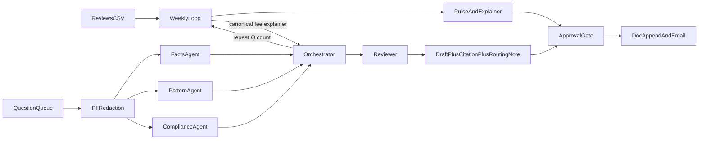

# The Support Desk

**Product:** [Groww](https://play.google.com/store/apps/details?id=com.nextbillion.groww&hl=en_IN) — the same Indian investment platform used in Milestone 1 (RAG FAQ assistant) and Milestone 3 (multi-agent reply desk).
**AMC in scope:** HDFC Mutual Fund — six schemes across two corpus snapshots (see §4.1).

---

## 1. Overview

The Support Desk is a **deployed web application** that runs the support and product loop for Groww. It turns raw user signal into grounded, compliance-checked outputs that a human must approve before anything is written or sent.

| Input | Output |
| --- | --- |
| Play Store reviews (CSV / `normalized_reviews.json`) | Theme clusters, weekly product pulse, fee explainer |
| Incoming user questions / complaints | Cited, compliance-checked reply drafts with internal routing notes |

Nothing leaves the system without a human approving that specific action.

---

## 2. Objective

Build one system that closes the loop between support and product:

1. **Reviews** come in and become **themes**.
2. **User questions** come in and become **cited, compliance-checked reply drafts**.
3. A **weekly pulse** goes out to the product team.
4. **Human approval** gates every write and every send.

---

## 3. Problem Context

Two teams are solving halves of the same problem, and neither can see the other half.

- **Support** answers the same fee question dozens of times a month (often ~40), writing the answer fresh each time and sometimes getting it wrong. Example: *"why was I charged an exit load?"*
- **Product** reads a review dashboard that says "pricing confusion is up" without saying *which* fee, or *what support has been telling people* about it.

A support agent answering that exit-load question needs three things at once, and they don't come from the same place:

1. **The fact** lives in a scheme document.
2. **The pattern** — whether forty other users asked the same thing this month — decides if this is a reply or an escalation.
3. **Compliance** — the draft must not give investment advice, must not quote a return figure, and must not echo back a PAN the user pasted into their complaint.

A single model asked to do all three does the first and forgets the rest: it writes a fluent, uncited paragraph ending in *"you may want to consider staying invested longer"*, which is advice.

The missing connective tissue is data neither team has in one place:

- What the **official documents** actually say
- What users are **actually confused** about
- **How often** that confusion shows up

That connective tissue is what this system builds.

---

## 4. What You Bring Forward

Prior milestones produced the building blocks. This capstone assembles them into one scheduled, deployed system.

| Milestone | Project | What you already have |
| --- | --- | --- |
| **Milestone 1 — RAG** | `RAG-Chatbot` | Facts-only FAQ assistant over official HDFC scheme pages (corpus snapshots, raw HTML and Chroma index now in `data/`, see §4.1). ≤ 3-sentence answers, exactly one citation link, "Last updated from sources: \<date\>" footer, polite refusal of advisory queries with an AMFI/SEBI educational link. |
| **Milestone 2** | MCP workflow | Review clustering into themes, weekly pulse, fee explainer, and an approval-gated MCP workflow (doc append + email draft, no auto-send). |
| **Milestone 3** | `Multi-Agentic-System` | LangGraph response desk: Facts, Pattern and Compliance agents in parallel → Orchestrator → Reviewer, with scoped refinement and the same approval-gated MCP. |

**What remains**

- Run both loops as **one system on a schedule**
- Build the **interface**
- Run **evaluations over the assembled whole**
- **Deploy** the working prototype

### 4.1 Facts corpus — two snapshots (from Milestone 1)

The facts corpus is made of **two read-only snapshots** of public Groww scheme pages. The second was copied **in addition to** the first, not as a replacement. Together they cover **six HDFC schemes**.

| Snapshot | Location | Captured | NAV date | Schemes | Sections per scheme |
| --- | --- | --- | --- | --- | --- |
| **A — parsed** | `data/parsed/` (`parse_manifest.json`, `scheme_count: 5`) | **2026-06-28** (`fetched_at`) | 25-Jun-2026 | `large_cap`, `mid_cap`, `small_cap`, `gold_fof`, `silver_fof` | 7 `text_blocks` |
| **B — processed** | `data/processed/` (copied from `RAG-Chatbot/backend/data/`) | **2026-09-01** (`scrape_date`) | 31-Aug-2026 | `large_cap`, `mid_cap`, `small_cap`, `gold_fof`, `elss_tax_saver` | 4 `sections` (Gold FoF: 3) |

Each block's `source_url` is its one citation link. The snapshot's capture date (`fetched_at` for A, `scrape_date` for B) is its "last checked" date.

| `scheme_id` | Scheme | `source_url` | Exit load | In snapshot |
| --- | --- | --- | --- | --- |
| `large_cap` | HDFC Large Cap Fund Direct Growth | https://groww.in/mutual-funds/hdfc-large-cap-fund-direct-growth | 1% if redeemed within 1 year | A, B |
| `mid_cap` | HDFC Mid Cap Fund Direct Growth | https://groww.in/mutual-funds/hdfc-mid-cap-fund-direct-growth | 1% if redeemed within 1 year | A, B |
| `small_cap` | HDFC Small Cap Fund Direct Growth | https://groww.in/mutual-funds/hdfc-small-cap-fund-direct-growth | 1% if redeemed within 1 year | A, B |
| `gold_fof` | HDFC Gold ETF Fund of Fund Direct Plan Growth | https://groww.in/mutual-funds/hdfc-gold-etf-fund-of-fund-direct-plan-growth | 1% if redeemed within 15 days | A, B |
| `silver_fof` | HDFC Silver ETF FoF Direct Growth | https://groww.in/mutual-funds/hdfc-silver-etf-fof-direct-growth | 1% if redeemed within 15 days | A only |
| `elss_tax_saver` | HDFC ELSS Tax Saver Fund Direct Plan Growth | https://groww.in/mutual-funds/hdfc-elss-tax-saver-fund-direct-plan-growth | Nil | B only |

**Snapshot A sections** (7 `text_blocks` per file):

- Key fund facts (NAV, expense ratio, min SIP/lumpsum, AUM, riskometer, category, plan)
- Exit load
- Benchmark
- Investment objective
- Stamp duty and tax
- Fund management
- Minimum investments

**Snapshot B sections:**

- Fund Overview (fund manager, NAV, riskometer, min SIP/lumpsum, exit load)
- Fund Details (min SIP, fund size, expense ratio)
- NAV & AUM
- Tax Info & Exit Load (exit load, stamp duty, tax implication)

Gold FoF has no Fund Overview.

**Supporting Milestone 1 artifacts.** These were copied with snapshot B. Agents don't read them at runtime.

- `data/raw/`: the source HTML for snapshot B, captured on 2026-08-30 and 2026-09-01, kept for provenance.
- `data/chroma_db/`: the Milestone 1 Chroma vector index. Collection `mf_facts`, 23 chunks of snapshot B, `models/gemini-embedding-001`, chunk size 500 with overlap 50.

**When the two snapshots overlap.** For a scheme in both snapshots, the **newer snapshot (B)** is used for a fact it contains, and snapshot A is the fallback. Benchmark, Investment objective and full Fund management details exist only in A. Every claim cites the snapshot block it was copied from, together with that block's own "last checked" date.

Anything outside these six schemes, or outside the sections present for a scheme, is **not covered**. Agents read these files. They don't scrape new pages or fall back on general knowledge.

> Note: the Milestone 1 brief originally listed HDFC ELSS Tax Saver Fund. Snapshot A carried HDFC Silver ETF FoF in its place, and snapshot B (the RAG-Chatbot backend data) restores ELSS. The capstone uses both snapshots, for a total of six schemes.

### 4.2 Reviews — `data/normalized_reviews.json` (from Milestone 2)

1,650 Play Store reviews (`source: "play_store"`), dated **2026-04-12** through **2026-07-04**.

- Fields: `id`, `source`, `rating` (1–5), `title`, `text`, `date`, `version` (some null).
- Rating split: 680×1, 95×2, 113×3, 157×4, 605×5.

### 4.3 Themes — `data/analyzed_themes.json` (from Milestone 2)

Top-level keys: `reviewCount`, `allThemes`, `topThemes`. Each theme has `id`, `name`, `description`, `reviewIds`, `count`, `avgRating`, `score`. Window: **2026-04-12 to 2026-07-04**.

| `id` | Name | Count | Avg rating | Score | In `topThemes` |
| --- | --- | ---: | ---: | ---: | --- |
| `other` | Other feedback | 709 | 3.5 | 1210.85 | no |
| `trading_charts` | Trading, charts & orders | 503 | 2.7 | 993.96 | yes |
| `money_movement` | Withdrawals, deposits & payments | 162 | 2.5 | 338.98 | yes |
| `reliability` | App stability & performance | 140 | 2.2 | 302.36 | yes |
| `fees_brokerage` | Fees & brokerage | 136 | 2.2 | 302.26 | no |

`topThemes` is the three highest-scoring themes excluding `other`. **`fees_brokerage` is the recurring fee/charge confusion** — it is the theme an exit-load or brokerage complaint should match, even though it sits just outside `topThemes`, and it is the source for the fee explainer.

---

## 5. System to Build

A deployed web application with **two loops**, a **connection between them**, and **scope enforcement in code**.

### 5.1 The weekly loop

Runs on a schedule (and on manual trigger) and completes without manual intervention.

1. Ingest the reviews CSV (`normalized_reviews.json`).
2. Cluster into a **maximum of five themes**, each carrying its `reviewIds`, `count` and the **window** it covers.
3. Identify the **top three** themes.
4. Pull the recurring **fee or charge confusion** (`fees_brokerage` — exit load, brokerage, other charges).
5. Generate the **weekly pulse**:
   - **250 words or fewer**
   - Supporting quotes (PII-redacted, traced to review ids)
   - **Three action ideas**
   - Repeat questions from the response loop (see §5.3)
6. Generate the **fee explainer**:
   - **Six bullets or fewer**
   - Facts-only, copied from the corpus (e.g. the exit-load `text_block`s)
   - **Two official source links** from §4.1
   - A **"last checked"** date
7. Send both through the **approval gate** before:
   - The doc append
   - The email draft (no auto-send)

### 5.2 The response loop

A queue of incoming user questions/complaints. For each one:

1. **Redact PII first** — PAN, Aadhaar, account numbers, phone numbers, emails and OTPs are removed **before anything is stored** or seen by a model.
2. Run the **three agents in parallel** as nodes of one LangGraph. None waits on or reads another's output. Each node makes **one model call** that returns an id or flag from a closed list; code in the node writes the output.

| Agent | Model returns | Code writes |
| --- | --- | --- |
| **Facts Agent** | One `scheme_id` and one section title, or neither | The answer copied from that `text_block` with **one citation link** (`source_url`). If either pick is missing: `"not covered"` plus the schemes and sections searched. |
| **Pattern Agent** | One `theme_id` from `allThemes` | Whether the issue is **recurring**, **rising** or a **one-off**, plus theme `id`, the **count** of `reviewIds`, and the **window**. Also the in-week repeat-question count from the queue. |
| **Compliance Agent** | `advice`, `performance_claim`, or neither | Those flags, plus a PII flag when the redaction scan found one. |

3. **Orchestrator** merges them into:
   - **Reply draft** — ≤ 3 sentences, facts-only, with its citation link and a **"last checked"** date. If a canonical fee explainer exists for the question, it is **reused** instead of drafting fresh.
   - **Internal routing note** — which team gets the ticket and why, with priority set from the Pattern signal.
   - When agents disagree (e.g. a clean fact but forty people asking the same thing this week), the orchestrator **says so** rather than replying and closing.
   - Advisory or return-figure requests get a polite facts-only refusal with an AMFI/SEBI educational link; performance questions link only to the official factsheet/scheme page.
4. **Reviewer** checks the draft before a human sees it. Hard fails:
   - An uncited factual claim
   - Anything that reads as advice
   - Any surviving PII

   On a hard fail the draft goes back to the orchestrator **once**, with the failure named. If the second attempt still fails, the draft is shown with the flag and **the send is not offered**.
5. A human **approves**, **edits**, or **rejects** each draft.
6. **Refinement** — on human pushback only the affected agents re-run (logged per refinement, capped at five):
   - *"Shorter"* → Orchestrator
   - *"They're asking about a different scheme"* → Facts Agent
   - *"Check if this is the fee issue from last week"* → Pattern Agent

### 5.3 The connection between the loops

Neither prior milestone did this on its own. Build the link and show it working:

| Signal | Effect |
| --- | --- |
| The response loop sees the **same question five times in a week** | That question **shows up in the weekly pulse**, with its count and window |
| The weekly loop identifies a **fee confusion** (`fees_brokerage`) and the explainer is approved | The explainer becomes the **canonical answer** the response loop **reuses** instead of drafting fresh, citing the explainer's source links |

### 5.4 Scope enforcement

Apply facts-only rules across **both** loops. Enforce in **code** (regex/allow-lists/validators), not only in prompts:

- No recommendations
- No buy or sell language
- No return or performance figures
- **No PII** stored anywhere, including logs and agent state (PAN, Aadhaar, account numbers, OTPs, emails, phone numbers)

---

## 6. Interface Requirements

The UI must provide:

| View | Purpose |
| --- | --- |
| **Queue view** | Incoming questions with draft replies, citations, routing notes, and any reviewer flags |
| **Weekly pulse view** | Themes, quotes, counts and windows behind them, plus repeat questions from the queue |
| **Sources panel** | Where every factual claim came from (`source_url`), with its last-checked date |
| **Approval screen** | Lists exactly what will be written and where, before anything is written |
| **Canonical fee explainers** | Shows the explainers the response loop is reusing |

Carry forward the Milestone 1 disclaimer, visible on every screen: *"Facts-only. No investment advice."*

---

## 7. Hard Rules

| Rule | Requirement |
| --- | --- |
| Grounding | Every factual claim carries **one source link** from the Milestone 1 corpus (§4.1) |
| Sources | **Public sources only** (Groww scheme pages, AMC, AMFI, SEBI) — no third-party blogs, no app back-end screenshots |
| Coverage gaps | When the corpus does not cover a question, the system **says so** and **names the schemes and sections it searched** |
| Theme provenance | Every theme traces to **review ids**; every count states the **window** it covers |
| Privacy | **No PII** anywhere in the dataset, the interface, the logs, or agent state |
| Human gate | Nothing is written or sent without a human approving **that specific action**; no auto-send |
| Length caps | Reply drafts ≤ **3 sentences**; pulse ≤ **250 words**; explainer ≤ **6 bullets** |
| Agent calls | One model call per agent node, returning an id or flag; code writes facts, counts and replies |
| Loop caps | Reviewer rework ≤ **1 round**; refinement ≤ **5** |

---

## 8. Evaluations

Run **at least three checks** over the **assembled system** (not isolated milestones).

### 8.1 Feasibility

- Every question in the queue produces a **draft** or an explicit **"not covered"**.
- Every theme carries **review ids** and a **stated window**.
- The pulse stays inside its **word cap**; the explainer stays inside its **bullet cap**.
- The weekly loop **completes without manual intervention** once triggered.
- All three agents return structured output on every question (carried over from the Milestone 3 20-complaint run).

### 8.2 Correctness of edits

- A human edit to a draft changes **only that draft**.
- Approving one action **does not trigger another**.
- Rejecting a draft leaves the queue **otherwise untouched**.
- Test each case and **diff the state before and after**.

### 8.3 Grounding and compliance

- Sample **fifteen claims** across both loops and confirm each traces to a **source link** or a **review id**.
- Feed in questions the corpus cannot answer (other AMCs, schemes or sections) and confirm the system **says so** and names what it searched.
- In **both loops**, rephrased and repeated (including later in the same session), run:
  - Advice requests (*"Should I redeem?"*, *"Is this scheme good?"*, *"Which fund is better?"*)
  - Return-figure requests (*"What returns should I expect?"*)
  - Messages containing a **PAN**, an **account number**, and a **phone number**
- Confirm every one is **refused or redacted**, and that **nothing sensitive reached the logs** or agent state.

---

## 9. Deliverables

### 9.1 GitHub repository

The README must cover:

- Architecture and setup
- Source list (§4.1)
- Where the approval gate sits
- How the two loops connect
- What fee issue came out of the reviews (`fees_brokerage` / exit-load confusion)
- How to run the evals
- Known limits

Also include in the repo:

- Reviews CSV sample
- Five sample questions with their drafts
- Appended doc entry
- Email draft
- Evaluation results

### 9.2 Working prototype link

A hosted app or notebook that demonstrates the system running.

### 9.3 Demo video (only if you cannot host)

Under **10 minutes**. Show:

1. Weekly loop running end to end
2. One question through the response loop
3. One reviewer rejection
4. The approval gate
5. One evaluation

---

## 10. Marks Basis

| Category | Weight |
| --- | --- |
| Intent (Idea) | 20 |
| MCP & System Design | 20 |
| Grounding & RAG | 20 |
| AI Evaluations | 20 |
| Automation | 10 |
| Deploy | 10 |
| **Total** | **100** |

---

## Summary Checklist

Use this as a quick compliance scan against the problem statement:

- [ ] Same product as Milestone 1 (Groww, six HDFC schemes, `data/parsed/` + `data/processed/` corpus snapshots)
- [ ] Deployed web app with weekly loop + response loop, on a schedule
- [ ] Three parallel agents → orchestrator → reviewer (one rework round)
- [ ] Cross-loop link: repeat questions (5×/week) → pulse; fee explainer → canonical reuse
- [ ] Facts-only + no PII, enforced in code
- [ ] Approval gate before every write/send; no auto-send
- [ ] Queue, pulse, sources, approval, and canonical explainer UI
- [ ] Three eval suites over the assembled system
- [ ] Repo artifacts, prototype link, and optional demo video if unhosted
